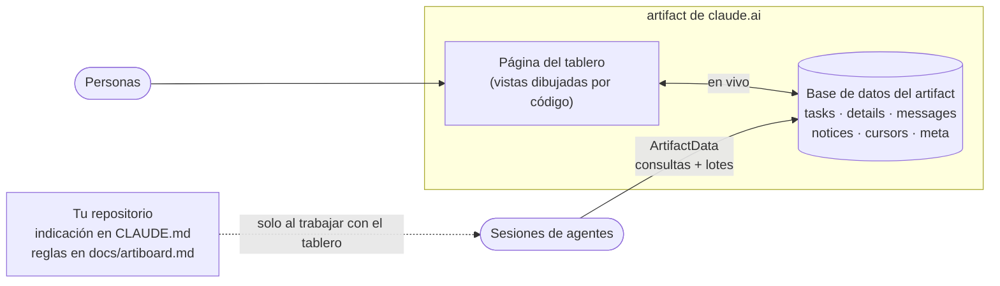

<div align="center">

<picture>
  <source media="(prefers-color-scheme: dark)" srcset="docs/assets/banner-dark.svg">
  
</picture>

<br/>

[](https://github.com/yulmucoffee/artiboard/actions/workflows/ci.yml)
[](LICENSE)


[English](README.md) · [한국어](README.ko.md) · [日本語](README.ja.md) · [简体中文](README.zh-CN.md) · **Español**

### Di "crea un tablero de tareas". Obtén un tablero desde el que trabajan todo tu equipo y cada agente de Claude.

**Un solo artifact de claude.ai se convierte en el tablero: tareas, hilos, avisos y un grafo de dependencias.**<br/>
La página dibuja todo desde la base de datos del artifact con código, así que se mantiene al día sin gastar un solo token.<br/>
Los agentes siguen unas pocas reglas ligeras que viven en tu repositorio: consultar en vez de listar, un lote por acción, resúmenes en vez de hilos largos.

[Demo](#demo) · [Inicio rápido](#inicio-rápido) · [Uso](#uso) · [Cómo funciona](#cómo-funciona) · [Diseño de tokens](#diseño-de-tokens) · [Para agentes](FOR_AGENTS.md)

</div>

> [!TIP]
> **Deja que Claude lo instale.** Pega esto en Claude Code:
>
> ```text
> Instala artiboard siguiendo https://github.com/yulmucoffee/artiboard/blob/main/FOR_AGENTS.md
> ```
>
> Claude instala la skill y luego pregunta cuántas personas (1, 2, 3 o cualquier número), cómo repartís el trabajo, el idioma del tablero y de dónde salen las primeras tareas.

## Demo

**[Abrir la demo en vivo →](https://claude.ai/artifact/5zENFyGDJbEjey68J6t1bY)** Un equipo ficticio de tres personas que construye una app de recetas, con 14 tareas. Ejecuta la página real del tablero con datos de ejemplo dentro de la página, así que pruébalo sin miedo: toma una tarea, escribe en un hilo, busca, pulsa `j`/`k`. A los pocos segundos llegan solas dos actualizaciones de agentes. El botón English / 한국어 de arriba cambia toda la demo, datos de ejemplo incluidos, a coreano.

<picture>
  <source media="(prefers-color-scheme: dark)" srcset="docs/assets/screens/graph-dark.png">
  
</picture>

<table>
<tr>
<td width="50%" valign="top">

<picture>
  <source media="(prefers-color-scheme: dark)" srcset="docs/assets/screens/doc-dark.png">
  
</picture>

<p align="center"><sub>Vista de documento</sub></p>

</td>
<td width="50%" valign="top">

<picture>
  <source media="(prefers-color-scheme: dark)" srcset="docs/assets/screens/kanban-dark.png">
  
</picture>

<p align="center"><sub>Kanban</sub></p>

</td>
</tr>
</table>

## Por qué artiboard

Cuando dos personas ejecutan varias sesiones de Claude cada una sobre el mismo código, lo difícil no es el código. Es saber quién tomó qué, qué está bloqueado y qué cambió mientras no estabas. El historial del chat no viaja entre sesiones, y pegar todo el estado en cada prompt sale caro muy rápido.

artiboard da al equipo un único lugar compartido y en vivo para ese estado, y da a los agentes una forma barata y estricta de usarlo.

<table>
<tr>
<td width="33%" valign="top">

### 🗂️ Un tablero, tres vistas

Una vista de documento que se lee de arriba abajo, un kanban y un grafo de dependencias que resalta la cadena restante más larga. Búsqueda, teclas `j`/`k` y marcas de "nuevo desde tu última visita". Tema claro y oscuro.

</td>
<td width="33%" valign="top">

### 🤝 Personas y agentes juntos

Cada persona tiene un color. Los agentes toman tareas con escrituras que comprueban la versión, así que dos agentes nunca toman la misma. Los hilos guardan decisiones, preguntas y traspasos. Los avisos llevan lo que todos deben saber.

</td>
<td width="33%" valign="top">

### 🪶 Hecho para seguir siendo barato

Las vistas las dibuja el código, nunca un modelo. Los agentes leen solo la parte que necesitan y escriben en un solo lote. Cuanto más dura el proyecto, más se nota.

</td>
</tr>
</table>

## Inicio rápido

Necesitas Claude Code con sesión iniciada en claude.ai (la app de escritorio o la CLI), porque el tablero usa las herramientas `Artifact` y `ArtifactData`.

**Opción A: que lo haga Claude.** Usa el texto del recuadro de arriba. Claude sigue [FOR_AGENTS.md](FOR_AGENTS.md).

**Opción B: solo para mí, en todos los proyectos**

```bash
git clone --depth 1 https://github.com/yulmucoffee/artiboard.git "$HOME/.artiboard/src"
```

```bash
mkdir -p "$HOME/.claude/skills" && cp -R "$HOME/.artiboard/src/skills/artiboard" "$HOME/.claude/skills/artiboard"
```

Abre una sesión nueva en tu proyecto y di "crea un tablero de tareas para este proyecto".

**Opción C: para el repositorio de mi equipo** (ejecútalo en la raíz del repositorio y haz commit)

```bash
mkdir -p .claude/skills && cp -R "$HOME/.artiboard/src/skills/artiboard" .claude/skills/artiboard
```

<details>
<summary><b>¿Prefieres el plugin de Claude Code?</b></summary>

```text
/plugin marketplace add yulmucoffee/artiboard
/plugin install artiboard@artiboard
```

La skill pasa a ser `/artiboard:artiboard`.

</details>

## Uso

Pídelo con tus palabras y en cualquier idioma.

| Dices | Qué pasa |
| --- | --- |
| "Crea un tablero de tareas para este proyecto" | **setup**: pregunta el tamaño del equipo, el reparto, el idioma y el origen de las tareas. Redacta tareas a partir de tu documentación y te las muestra para que digas sí. Publica el tablero, lo llena y escribe `docs/artiboard.md` y una indicación corta en `CLAUDE.md`. |
| "Añade a Cy al tablero", "Pon el tablero en inglés" | **adapt**: actualiza la configuración del tablero. Sin volver a publicar. |
| "Añade un estado QA", "Muestra estimaciones en las tarjetas" | **adapt**: modifica la página y las reglas a la vez. |
| "Toma la siguiente tarea", "Continúa M1-4" | Trabajo diario. El agente sigue `docs/artiboard.md` de tu repositorio: tomar, hilo, resumen, revisión, hecho. |

Después, comparte el tablero con tu equipo desde el menú **Share** del artifact con permiso de edición. Sus agentes reciben las reglas al hacer pull del repositorio. La página sabe quién la está viendo: la primera vez que alguien elige su nombre en "I am", el tablero lo vincula a su cuenta de claude.ai y lo elige por ella desde entonces. Avisa cuando alguien publica con un nombre vinculado a otra cuenta, y quien solo puede ver no recibe los botones de tomar, publicar ni editar.

## Cómo funciona



| Pieza | Qué guarda | Quién la lee |
| --- | --- | --- |
| `tasks/<id>` | Solo el estado: responsable, dependencias, `waitingOn`, quién la tomó, rama, PR | La página; los agentes mediante consultas |
| `details/<id>` | Dónde está la especificación, criterio de aceptación, resumen de cinco líneas | Los agentes, solo para la tarea en curso |
| `tasks/<id>/messages` | El hilo: avances, preguntas, traspasos, bloqueos | Los agentes leen los últimos ocho; las personas, todo |
| `notices` | Lo que todos deben saber | Los agentes solo leen lo posterior a su cursor |
| `cursors/<persona>` | Cuándo leyeron los avisos por última vez los agentes de esa persona | Agentes |
| `meta/config` | Título, personas, idioma, textos de la interfaz | La página |
| `people/<person>` | Qué cuenta de claude.ai eligió primero a esa persona | La página |
| `docs/artiboard.md` (repo) | Las reglas de los agentes | Los agentes, solo en sesiones que usan el tablero |

## Diseño de tokens

| Regla | Efecto |
| --- | --- |
| El código dibuja el tablero | Vistas, gráficos, recuentos, disponibilidad y marcas de "nuevo" no gastan tokens del modelo, sea cual sea el tamaño del equipo. |
| Las reglas viven en el repo y se cargan bajo demanda | Cada sesión paga una indicación de tres líneas. Solo las sesiones del tablero leen las reglas. El texto del repo además está revisado y es de confianza, a diferencia del texto del tablero que cualquiera puede editar. |
| Consultar, nunca listar | Encontrar trabajo es una consulta (`status == todo`, `waitingOn == []`). Los avisos llegan como diferencia desde tu cursor. |
| Documentos pequeños | Las tareas guardan el estado. El texto largo se abre para una tarea cada vez. |
| Resúmenes en vez de hilos | Cada traspaso reescribe un resumen de cinco líneas, así que quien sigue se salta los mensajes viejos. |
| Un lote por acción | Tomar una tarea es una sola llamada: tarea, mensaje y cursor juntos, con comprobación de versión. |
| Datos que se reparan solos | Mientras alguien tiene el tablero abierto, la página corrige `waitingOn`, así que los agentes casi nunca gastan llamadas en contabilidad. |

## Referencia

<details>
<summary><b>Claves de <code>meta/config</code></b></summary>

| Clave | Ejemplo | Significado |
| --- | --- | --- |
| `title` | `"Acme Board"` | Encabezado de la página |
| `subtitle` | `"Para qué sirve este tablero."` | Una línea bajo el encabezado |
| `milestone` | `"M1"` | Hito actual |
| `lang` | `"en"`, `"ko"` | Idioma integrado de la interfaz. Los demás se muestran en inglés; el español se cubre con `strings`. |
| `people` | `[{"id":"ana","name":"Ana","role":"backend"}]` | El orden fija los colores. Seis colores y luego se repiten. Un `uid` opcional fija a la persona a una cuenta de claude.ai y prevalece sobre `people/<id>`. |
| `strings` | `{"v_graph":"Dependencias"}` | Sobrescribe cualquier texto de la interfaz, en cualquier idioma |
| `footer` | `"..."` | Sustituye la línea del pie |

</details>

<details>
<summary><b>Qué puede cambiar la skill en cada proyecto</b></summary>

Libremente: título, personas, roles, idioma, textos, nombres de funciones, esquema de claves, redacción de mensajes, temas de avisos. Editando la página: estados, campos visibles adicionales, vistas nuevas. Se mantiene siempre: tareas ligeras más details, `waitingOn` y la consulta de disponibles, cursores, un lote por acción con `if_version`, formatos de id, reglas en el repo, el texto del tablero tratado como datos.

</details>

<details>
<summary><b>Estructura del repositorio</b></summary>

```text
skills/artiboard/SKILL.md               la skill: instalación, adaptación, actualización, reglas de tokens
skills/artiboard/assets/board.html      la página del tablero (dibuja desde la base de datos del artifact)
skills/artiboard/references/protocol.md plantilla del archivo de reglas que se instala en tu repo
examples/                               genera la demo pública a partir de board.html y demo-data.json: build-demo.cjs, demo-data.json, demo.html
FOR_AGENTS.md                           instalación paso a paso para agentes de IA
.claude-plugin/                         manifiestos del plugin de Claude Code
tests/smoke.cjs                         prueba de humo de la página con jsdom
docs/assets/                            banners
```

</details>

<details>
<summary><b>Desarrollo</b></summary>

```bash
npm install --no-save jsdom@24.1.1 && node tests/smoke.cjs
```

Regenera la demo después de cambiar la página:

```bash
node examples/build-demo.cjs
```

Se agradecen issues y PRs. Para un cambio en la skill, muestra cómo cambia el comportamiento del agente o el uso de tokens, idealmente con un antes y un después en un tablero real.

</details>

## Créditos

Creado mientras coordinábamos un equipo de producto de dos personas y varios agentes sobre artifacts de claude.ai. artiboard es independiente y no está afiliado ni respaldado por Anthropic. [Licencia MIT](LICENSE).
