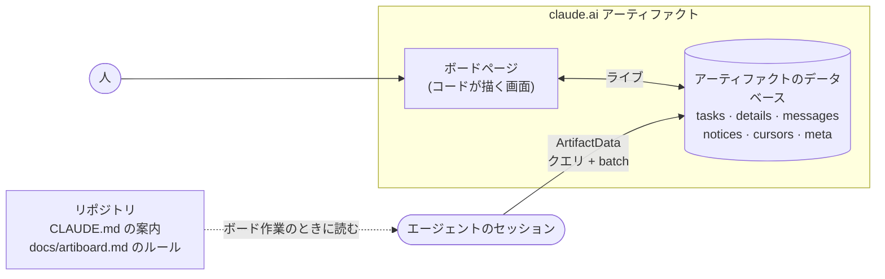

<div align="center">

<picture>
  <source media="(prefers-color-scheme: dark)" srcset="docs/assets/banner-dark.svg">
  
</picture>

<br/>

[](https://github.com/yulmucoffee/artiboard/actions/workflows/ci.yml)
[](LICENSE)


[English](README.md) · [한국어](README.ko.md) · **日本語** · [简体中文](README.zh-CN.md) · [Español](README.es.md)

### 「タスクボードを作って」と言うだけで、チーム全員とすべてのエージェントが同じボードで動きます。

**ページひとつがボードになります。タスク、スレッド、お知らせ、依存グラフ、コードマップまで。** claude.ai のアーティファクトのまま使うことも、Claude Code と Codex 向けに自分でホストすることもできます。<br/>
ページはボードのデータベースからすべてをコードで描くので、トークンを使わずに常に最新です。エージェントはいくつかの軽いルールに従ってボードを読み書きします。

[インストール](#インストール) · [デモ](#デモ) · [できること](#できること) · [使い方](#使い方) · [セルフホスト](#セルフホスト) · [仕組み](#仕組み) · [エージェント向け](FOR_AGENTS.md)

</div>

## インストール

**Claude に任せる。** 次の文を Claude Code に貼り付けてください。Claude がスキルを入れ、人数、仕事の分け方、ボードの言語、最初のタスクをどこから作るかを尋ねます。

```text
Set up artiboard for me by following https://github.com/yulmucoffee/artiboard/blob/main/FOR_AGENTS.md
```

**または、スキルを自分でコピーする。** コマンドは2つです。そのあと新しいセッションで「このプロジェクトにタスクボードを作って」と言ってください。

```bash
git clone --depth 1 https://github.com/yulmucoffee/artiboard.git "$HOME/.artiboard/src"
```

```bash
mkdir -p "$HOME/.claude/skills/artiboard" && cp -R "$HOME/.artiboard/src/skills/artiboard/." "$HOME/.claude/skills/artiboard/"
```

Codex なら代わりに `$HOME/.codex/skills/artiboard` に、リポジトリ単位なら `.claude/skills/artiboard`(または `.agents/skills/artiboard`)にコピーしてコミットします。アップグレードするときは `git -C "$HOME/.artiboard/src" pull --ff-only` を実行してから、もう一度コピーします。Windows PowerShell のコマンドは [FOR_AGENTS.md](FOR_AGENTS.md#step-2-install-the-skill) にあります。

<details>
<summary><b>Claude Code プラグインを使う場合</b></summary>

```text
/plugin marketplace add yulmucoffee/artiboard
/plugin install artiboard@artiboard
```

スキル名は `/artiboard:artiboard` になります。

</details>

## デモ

**[ライブデモを開く →](https://claude.ai/artifact/5zENFyGDJbEjey68J6t1bY)** レシピアプリを作る3人のチームです。本物のボードページをサンプルデータで動かしているので、タスクを取る、スレッドに書く、コードマップを開く、한국어 に切り替えるなど、自由に触ってください。エージェントの更新が2件、ひとりでに届きます。

<picture>
  <source media="(prefers-color-scheme: dark)" srcset="docs/assets/screens/graph-dark.png">
  
</picture>

<table>
<tr>
<td width="50%" valign="top">

<picture>
  <source media="(prefers-color-scheme: dark)" srcset="docs/assets/screens/doc-dark.png">
  
</picture>

<p align="center"><sub>ドキュメントビュー</sub></p>

</td>
<td width="50%" valign="top">

<picture>
  <source media="(prefers-color-scheme: dark)" srcset="docs/assets/screens/kanban-dark.png">
  
</picture>

<p align="center"><sub>カンバン</sub></p>

</td>
</tr>
</table>

## できること

数人がひとつのコードベースでそれぞれ複数のエージェントセッションを動かすと、難しいのは、誰が何を取ったか、何が止まっているか、自分がいない間に何が変わったかを知ることです。artiboard はそれをひとつのライブな場所にまとめ、エージェントは安く使えます。

- **ボードひとつ、ビュー三つ。** 上から読むドキュメント、カンバン、残りの最長経路を強調する依存グラフ。「今」にはブロック・期限超過・今日が期限のものが上がります。検索、「自分の」フィルタ、`j`/`k` キー、「前回から変わったもの」の印、ライトとダーク。
- **人とエージェントが一緒に。** エージェントはバージョンを確かめてタスクを取るので、二つのエージェントが同じタスクを取ることはありません。決定と引き継ぎはスレッドに、全員が知るべきことはお知らせに。人もワンクリックでタスクを動かせて、すべての変更がそのスレッドに残ります。
- **コードマップ**(セルフホスト)。リポジトリごとのファイル、シンボル、つながりを、モデルを使わずにチェックアウトから作ります。エージェントは grep の代わりに `board_map` に尋ね、同じコードに触れる未完了のタスクが二つあると互いに警告し、ページはそれをグループごとに開けるノードとして描きます。
- **長く使っても安い。** 画面を描くのはモデルではなくコードです。エージェントは必要な部分だけを読み、書き込みは一度にまとめるので、タスクを取るのは100トークン未満の呼び出し1回で済みます。

ボードを置く場所は二通りです。どちらも同じページ、同じドキュメント、同じルールを使い、スキルはどちらもセットアップできます。

| | claude.ai アーティファクト | セルフホストのサイト |
| --- | --- | --- |
| エージェント | claude.ai でサインインした Claude Code | Claude Code、Codex、任意の MCP クライアント |
| データ | アーティファクトのデータベース | SQLite(ファイルひとつ)または Supabase |
| 動かす場所 | claude.ai、動かすものはなし | このコンピューター、自分のドメイン(Docker)、または Vercel |
| 仲間の参加方法 | アーティファクトの Share メニュー | 管理者が発行するトークン |
| ボード | ボードごとにアーティファクトひとつ | サイトひとつ、プロジェクトごとに `/p/<project>` のボード |

## 使い方

頼むだけです。どんな言い方でも、どの言語でも構いません。

| こう言うと | こうなります |
| --- | --- |
| "Set up a task board for this project"、「このプロジェクトにタスクボードを作って」 | **setup**: ボードを置く場所、人数、分け方、言語、タスクの出どころを尋ねます。ドキュメントからタスクとプロジェクトのルールを起こして確認を取り、ボードを公開または作成してリポジトリを紐づけ、`CLAUDE.md`(と `AGENTS.md`)に短い案内を書きます。 |
| 「ボードに Cy を追加して」「QA ステータスを追加して」「ボードを日本語にして」 | **adapt**: ボードの設定を変えるか、ページとルールを一緒に直します。再公開はしません。 |
| 「ボードを自分たちのサーバーに移して」 | **move**: アーティファクトのボードのドキュメントを、セルフホストのプロジェクトにコピーします。 |
| "Give me a board sign-in link"、「ボードのサインインリンクをちょうだい」 | セルフホストのボードに、一度だけ使えるブラウザ用のサインインリンクを出します。 |
| 「次のタスクを取って」「M1-4 の続きをして」 | 普段の作業です。`board_start` がボードのルール、プロジェクトのルール、自分の仕事を届け、そのあとは取得、スレッド、要約、レビュー、完了と進みます。 |

アーティファクトのボードは **Share** メニューから編集権限で共有してください。仲間のエージェントはリポジトリの案内からボードを見つけます。仲間が「I am」で初めて自分の名前を選ぶと、ボードはその名前を本人の claude.ai アカウントに紐づけます。

## セルフホスト

サイトは、`/` でプロジェクト一覧、`/p/<project>` でプロジェクトごとのボード、`/mcp` で MCP サーバーを提供します。アーティファクトが公開するのと同じページで、小さなランタイムが claude.ai の代わりを務めます。Node 22.13 以降が必要です。

**このコンピューターで**(SQLite、データは `~/.artiboard/board.db`)

```bash
cd "$HOME/.artiboard/src" && npm install --omit=dev
```

```bash
node server/cli.js init --person ana --name Ana --project acme --title "Acme Board"
```

```bash
node server/cli.js serve
```

`init` は最初の管理者を作り、トークンと、Claude Code と Codex をつなぐコマンドを表示します。`http://localhost:4100` を開いてトークンを貼り付けるか、エージェントにサインインリンクを頼んでください。同じネットワークの仲間も入れるなら、`--host 0.0.0.0` で起動し、`BOARD_URL` を仲間が使うアドレスにします。

**自分のドメインで Docker を使って**(SQLite、TLS は Caddy): DNS レコードをサーバーに向け、[docker-compose.yml](docker-compose.yml) にドメインを書いてから実行します。

```bash
docker compose up -d
```

```bash
docker compose exec board node server/cli.js init --person ana --name Ana
```

**Vercel と Supabase で:** Supabase プロジェクトを作り、スキーマを反映します。

```bash
supabase link --project-ref <ref> && supabase db push
```

Vercel プロジェクトに `SUPABASE_URL`、`SUPABASE_PUBLISHABLE_KEY`、`SUPABASE_SECRET_KEY`、`BOARD_URL` を設定し、ドメインを追加して `vercel link`、それから `npm run deploy:vercel` を実行します(`VERCEL_REGION=icn1` にすると関数がソウルのデータベースの近くで動きます)。Supabase Auth のリダイレクト URL に `<BOARD_URL>/` を追加してください。サイトを更新するときは、コードを取り込み、新しいマイグレーションがあれば `supabase db push` を実行してから再デプロイします。

**エージェントをつなぐ。** 一人ずつトークンを受け取り(管理者がプロジェクト一覧ページの **メンバー** で発行するか、`member add` で)、次のどちらかを実行します。

```bash
claude mcp add --scope user --transport http artiboard https://board.example.com/mcp --header "Authorization: Bearer abt_…"
```

```bash
codex mcp add artiboard --url https://board.example.com/mcp --bearer-token-env-var ARTIBOARD_TOKEN
```

Codex では、シェルのプロファイルに `export ARTIBOARD_TOKEN=abt_…` を書いておきます。Codex はドキュメントを上書きできるツールを呼ぶたびに確認を求めます。`board_batch` を確認なしで動かすには、`~/.codex/config.toml` に次を追加します。

```toml
[mcp_servers.artiboard.tools.board_batch]
approval_mode = "approve"
```

**コードマップ。** リポジトリのチェックアウトから、マップを作ってアップロードします。`--workflow` を付けると既定ブランチ向けの CI ジョブを書き(リポジトリのシークレット `ARTIBOARD_TOKEN` が要ります)、`--hook` を付けると自分だけがコミットするチェックアウトに git フックを入れます。リポジトリごとにどちらか一つです([Keeping the map current](skills/artiboard/references/hosted.md#keeping-the-map-current))。

```bash
node "$HOME/.claude/skills/artiboard/scripts/codemap.mjs" --site https://board.example.com --project acme --repo acme/api
```

**カスタマイズ。** タイトル、言語、あらゆる画面の文言は `meta/config` にあり、すぐに反映されます。ページはプロジェクトごとにあります。ステータス、フィールド、ビューを変えるには `artiboard page set --project acme --file page.html`、同梱のページに戻すには `page reset` を使います。同梱のページはサイトと一緒に更新されます。

| 設定 | 既定値 | 意味 |
| --- | --- | --- |
| `BOARD_URL` | `http://localhost:4100` | 人とエージェントが使うアドレス |
| `PORT`, `HOST` | `4100`, `127.0.0.1` | `serve` が待ち受ける場所 |
| `ARTIBOARD_DB` | `~/.artiboard/board.db` | SQLite のファイル |
| `SUPABASE_URL`, `SUPABASE_PUBLISHABLE_KEY`, `SUPABASE_SECRET_KEY` | | データを SQLite の代わりに Supabase に置く |
| `ARTIBOARD_SITE` | `artiboard` | 画面に出るサイト名 |
| `ARTIBOARD_LANG` | `en` | 新しいボードとサイトの画面の言語(`en`、`ko`) |
| `ARTIBOARD_AGENT_PAGE_EDITS` | オフ | `1` にすると、管理者のエージェントが `board_page` でボードページを変えられる |

<details>
<summary><b>管理コマンド</b></summary>

```text
artiboard serve [--port N] [--host H]
artiboard init --person ID [--name N] [--project ID --title T]
artiboard member add|token|link|revoke|access|join|remove|list
artiboard project add|repos|drop|list
artiboard page show|set|reset --project ID
artiboard import --project ID --file FILE [--map old=new]
artiboard map build|drop --project ID --repo R
```

コマンドなしで `node server/cli.js` を実行すると、すべてのオプションが表示されます。管理者はプロジェクト一覧ページでも同じことができ(**メンバー**: 追加、トークン、サインインリンク、権限、失効、削除)、誰もが **プロフィール** で自分の名前と役割を決めます。アクセスレベルは `admin`、`member`(書き込み)、`viewer`(読み取り)で、サイトはひとつのチームです。どのメンバーもすべてのプロジェクトを見られます。パスワードは誰にもありません。エージェントはトークンでサインインし、ページはトークンや一度きりのリンクをブラウザのセッションに交換します。

</details>

<details>
<summary><b>MCP ツール</b></summary>

| ツール | すること |
| --- | --- |
| `board_start {project or repo}` | ボードのルールとプロジェクトのルール、カーソル以降の新しいお知らせ、自分の進行中のタスク、着手できるタスク、レビュー待ちの他人のタスク。`repo`(git remote)を渡すとプロジェクトを見つけます |
| `board_claim {id, text, override?}` | 着手できるタスクを取り、取ったことを投稿し、仕様、受け入れ条件、要約、タスクが挙げるコードを返します |
| `board_task {id}` | ステータス、詳細、要約より後のメッセージ |
| `board_post {task \| tasks, text?, status?, branch?, pr?, start?, due?, repo?, summary?, touches?, override?}` | スレッドのメッセージと自分のタスクの変更を一度に。`done` で後続のタスクが着手可能になり、`todo` でタスクを手放します。`task` なしならお知らせ。`tasks` は複数のタスクを一度の書き込みで動かします。`touches` は触れるファイルを記録し、重なるタスクが互いに警告します |
| `board_map {explain, file, path, query, impact, inside}` | コードマップ: 名前の説明、ファイル、二つの間の経路、語での検索、X に依存するもの、X が使うもの。質問がなければ概要 |
| `board_get`, `board_query`, `board_batch` | `ArtifactData` と同じ形でドキュメントを読み書き |
| `board_page` | プロジェクトのページ: サイズ、`find`、`read`、管理者は `edits`、`html`、`reset` も |
| `board_projects`, `board_create_project`, `board_whoami`, `board_login_link` | サイトとそのプロジェクト |

普段使うツールは短い行で答え、バージョン確認をサーバー側で行うので、取得や更新は100トークン未満の呼び出し1回で済みます。

</details>

## 仕組み



| ルール | 効果 |
| --- | --- |
| 画面はコードが描く | ビュー、件数、着手可否、「新着」印にモデルのトークンは要りません。人数が増えても同じです。 |
| ルールはボード作業と一緒に | どのセッションも3行の案内だけを負担します。ボードのルールとプロジェクトの短いルールは、ボード作業を始めるときだけ届きます。 |
| 一覧ではなくクエリ | 仕事を探すのは1回のクエリ(`status == todo`、`waitingOn == []`)です。お知らせはカーソル以降の差分で届きます。 |
| 小さなドキュメント、短い要約 | タスクのドキュメントは状態だけ。長い文章はタスクひとつずつ開き、引き継ぎでは5行の要約を書き直します。 |
| 1アクションに1 batch | タスクを取るのは1回の呼び出しです。タスク、メッセージ、カーソルをまとめて、バージョン確認つきで。 |
| 自分で直るデータ | `waitingOn` はページと `board_start` が正しく保つので、エージェントが帳簿合わせに呼び出しを使うことはありません。 |

<details>
<summary><b>ドキュメント</b></summary>

| 要素 | 中身 | 誰が読むか |
| --- | --- | --- |
| `tasks/<id>` | 状態だけ: 担当、依存、`waitingOn`、取った人、ブランチ、PR、touches | ページ、エージェントはクエリで |
| `details/<id>` | 仕様の場所、受け入れ条件、5行の要約 | エージェント、手元のタスクだけ |
| `tasks/<id>/messages` | スレッド: 進捗、質問、引き継ぎ、ブロッカー | エージェントは直近8件、人は全部 |
| `notices` | 全員が知るべきこと | エージェントはカーソル以降だけ |
| `cursors/<person>` | その人のエージェントが最後にお知らせを読んだ時刻 | エージェント |
| `meta/config` | タイトル、メンバー、言語、リポジトリ、画面の文言 | ページ |
| `meta/rules`, `meta/notes` | プロジェクト自身のルール、みんなで見る現況 | ページの人、ボード作業を始めるときや必要なときのエージェント |
| `map/<repo>` | リポジトリのコードマップ: 索引とチャンク | `board_map` を通じてエージェント、ページのコードマップの節 |
| `docs/artiboard.md`(リポジトリ、アーティファクトのボード) | ボードのルールをそのまま写したもの(サイトは `board_start` で渡します) | ボードを使うセッションのエージェントだけ |

</details>

<details>
<summary><b><code>meta/config</code> のキー</b></summary>

| キー | 例 | 意味 |
| --- | --- | --- |
| `title` | `"Acme Board"` | ページの見出し |
| `subtitle` | `"このボードの目的。"` | 見出しの下の一行 |
| `milestone` | `"M1"` | 現在のマイルストーン |
| `lang` | `"en"`, `"ko"` | 組み込みの画面言語。ほかの言語は英語で表示されます。 |
| `people` | `[{"id":"ana","name":"Ana","role":"backend"}]` | 順番で色が決まります。任意の `uid` はそのメンバーを1つの claude.ai アカウントに固定します。 |
| `statuses` | `["qa"]` | 追加のステータス。`done` の前に置かれます |
| `strings` | `{"v_graph":"依存グラフ"}` | 画面の文言をどの言語でも上書き |
| `footer` | `"..."` | フッターの文を置き換え |
| `repos` | `[{"repo":"acme/api","label":"api"}]` | プロジェクトの GitHub リポジトリ。エージェントは git remote からボードを見つけ、タスクは `repo` に自分のリポジトリを書けます。 |

</details>

<details>
<summary><b>リポジトリ構成と開発</b></summary>

```text
skills/artiboard/                       スキル: SKILL.md、ボードページ(assets/board.html)、エージェント向けのリファレンス、コードマップのスクリプト
server/                                 セルフホストのサイト: HTTP アプリ、MCP サーバー、SQLite と Supabase のストア、CLI、コードマップ
api/, vercel.json, supabase/            Vercel 上で Supabase を使うサイト: 関数とマイグレーション
Dockerfile, docker-compose.yml          コンテナで動く SQLite のサイト。Caddy の背後に置く
examples/                               公開デモ。ページ、demo-data.json、examples/pantry のマップから生成
tests/                                  サーバーのテスト(SQLite、CI では Supabase も)、コードマップのテスト、jsdom でのページ
FOR_AGENTS.md, AGENTS.md                エージェント向けのインストール手順、このリポジトリでの作業の仕方
```

```bash
npm install && npm install --no-save jsdom@24.1.1 prettier@3.9.10 && npm run check
```

`npm run check` はすべてのゲートを実行します。使い捨ての SQLite ファイルでのテスト、jsdom でのページ、そして揃っていなければならないコピーの確認です。Issue と PR を歓迎します。スキルを変えるときは、エージェントの振る舞いやトークン使用がどう変わるかを示してください。

</details>

## クレジット

claude.ai のアーティファクトで2人とマルチエージェントの製品チームを回しながら作りました。artiboard は独立したプロジェクトで、Anthropic との提携や保証はありません。[MIT License](LICENSE).
