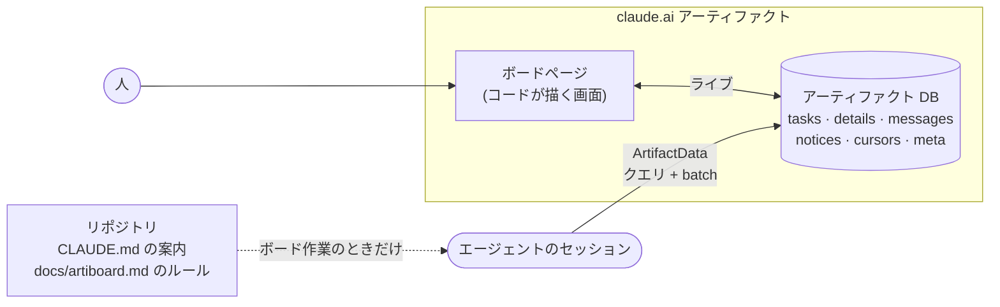

<div align="center">

<picture>
  <source media="(prefers-color-scheme: dark)" srcset="docs/assets/banner-dark.svg">
  
</picture>

<br/>

[](https://github.com/yulmucoffee/artiboard/actions/workflows/ci.yml)
[](LICENSE)


[English](README.md) · [한국어](README.ko.md) · **日本語** · [简体中文](README.zh-CN.md) · [Español](README.es.md)

### 「タスクボードを作って」と言うだけで、チーム全員とすべての Claude エージェントが同じボードで動きます。

**claude.ai のアーティファクトひとつがボードになります。タスク、スレッド、お知らせ、依存グラフまで。**<br/>
画面はページのコードがアーティファクトのデータベースから直接描くので、トークンを使わずに常に最新です。<br/>
エージェントはリポジトリに置いた短いルールに従います。一覧ではなくクエリで読み、書き込みは一度にまとめ、長いスレッドの代わりに要約を読みます。

[デモ](#デモ) · [クイックスタート](#クイックスタート) · [使い方](#使い方) · [仕組み](#仕組み) · [トークン設計](#トークン設計) · [エージェント向け](FOR_AGENTS.md)

</div>

> [!TIP]
> **セットアップは Claude に任せましょう。** Claude Code にこう貼り付けてください。
>
> ```text
> https://github.com/yulmucoffee/artiboard/blob/main/FOR_AGENTS.md に従って artiboard をセットアップして
> ```
>
> Claude がスキルを入れたあと、人数(1人、2人、3人、または任意の数)、仕事の分け方、ボードの言語、最初のタスクをどこから作るかを尋ねます。

## デモ

**[ライブデモを開く →](https://claude.ai/artifact/5zENFyGDJbEjey68J6t1bY)** レシピアプリを作る架空の3人チームと14個のタスクです。本物のボードページをページ内のサンプルデータで動かしているので、自由に触ってください。タスクを取る、スレッドに書く、検索、`j`/`k` で移動。数秒後にエージェントの更新が2件、ひとりでに届きます。 上部の English / 한국어 ボタンで、サンプルデータも含めてデモ全体を韓国語に切り替えられます。

<picture>
  <source media="(prefers-color-scheme: dark)" srcset="docs/assets/screens/graph-dark.png">
  
</picture>

<table>
<tr>
<td width="50%" valign="top">

<picture>
  <source media="(prefers-color-scheme: dark)" srcset="docs/assets/screens/doc-dark.png">
  
</picture>

<p align="center"><sub>ドキュメントビュー</sub></p>

</td>
<td width="50%" valign="top">

<picture>
  <source media="(prefers-color-scheme: dark)" srcset="docs/assets/screens/kanban-dark.png">
  
</picture>

<p align="center"><sub>カンバン</sub></p>

</td>
</tr>
</table>

## なぜ artiboard か

2人が同じコードベースでそれぞれ複数の Claude セッションを動かすと、難しいのはコードではありません。誰が何を取ったか、何が止まっているか、自分がいない間に何が変わったかを知ることです。チャットの履歴はセッションをまたげず、毎回すべての状況をプロンプトに貼るとコストがすぐに膨らみます。

artiboard はその状況をチームで共有するライブなボードひとつにまとめ、エージェントにはそれを安く厳密に使う方法を与えます。

<table>
<tr>
<td width="33%" valign="top">

### 🗂️ ボードひとつ、ビュー三つ

上から読むドキュメントビュー、カンバン、残りの最長経路を強調する依存グラフ。検索、`j`/`k` キー、「前回から変わったもの」の印。ライトとダーク。

</td>
<td width="33%" valign="top">

### 🤝 人とエージェントが一緒に

一人ひとりに色があります。エージェントはバージョンを確かめてタスクを取るので、二つのエージェントが同じタスクを取ることはありません。決定、質問、引き継ぎはスレッドに、全員が知るべきことはお知らせに。

</td>
<td width="33%" valign="top">

### 🪶 長く使っても安い

画面を描くのはモデルではなくコードです。エージェントは必要な部分だけを読み、書き込みは一度にまとめます。プロジェクトが長くなるほど差が開きます。

</td>
</tr>
</table>

## クイックスタート

ボードは `Artifact` と `ArtifactData` ツールを使うので、claude.ai でサインインした Claude Code(デスクトップアプリまたは CLI)が必要です。

**方法 A: Claude に任せる。** 上のボックスの文を貼り付けてください。Claude が [FOR_AGENTS.md](FOR_AGENTS.md) に従います。

**方法 B: 自分だけ、すべてのプロジェクトで**

```bash
git clone --depth 1 https://github.com/yulmucoffee/artiboard.git "$HOME/.artiboard/src"
```

```bash
mkdir -p "$HOME/.claude/skills/artiboard" && cp -R "$HOME/.artiboard/src/skills/artiboard/." "$HOME/.claude/skills/artiboard/"
```

プロジェクトで新しいセッションを開き、「このプロジェクトにタスクボードを作って」と言ってください。

**方法 C: チームのリポジトリに**(リポジトリのルートで実行してコミット)

```bash
mkdir -p .claude/skills/artiboard && cp -R "$HOME/.artiboard/src/skills/artiboard/." .claude/skills/artiboard/
```

アップグレードするときは `git -C "$HOME/.artiboard/src" pull --ff-only` を実行してから、同じコピーコマンドをもう一度実行します。Windows PowerShell では [FOR_AGENTS.md](FOR_AGENTS.md#step-2-install-the-skill) のコマンドを使ってください。

<details>
<summary><b>Claude Code プラグインを使う場合</b></summary>

```text
/plugin marketplace add yulmucoffee/artiboard
/plugin install artiboard@artiboard
```

スキル名は `/artiboard:artiboard` になります。

</details>

## 使い方

どんな言い方でも、どの言語でも構いません。

| こう言うと | こうなります |
| --- | --- |
| 「このプロジェクトにタスクボードを作って」 | **setup**: 人数、分け方、言語、タスクの出どころを尋ねます。ドキュメントからタスクを起こして確認を取り、ボードを公開してデータを入れ、`docs/artiboard.md` と `CLAUDE.md` の短い案内を書きます。 |
| 「ボードに Cy を追加して」「ボードを英語にして」 | **adapt**: ボードの設定だけを変えます。再公開しません。 |
| 「QA ステータスを追加して」「カードに見積もりを出して」 | **adapt**: ページとルールを一緒に直します。 |
| 「次のタスクを取って」「M1-4 の続きをして」 | 普段の作業です。エージェントがリポジトリの `docs/artiboard.md` に従います。 |

セットアップ後、アーティファクトの **Share** メニューから仲間に編集権限で共有してください。仲間のエージェントはリポジトリを pull するとルールを読みます。 ページは誰が見ているかを知っています。仲間が「I am」で初めて自分の名前を選ぶと、その claude.ai アカウントに紐づけ、次からは自動で選びます。別のアカウントに紐づいた名前で投稿しようとすると警告し、閲覧のみのユーザーには取得・投稿・編集のボタンを出しません。

## 仕組み



| 要素 | 中身 | 誰が読むか |
| --- | --- | --- |
| `tasks/<id>` | 状態だけ: 担当、依存、`waitingOn`、取った人、ブランチ、PR | ページ、エージェントはクエリで |
| `details/<id>` | 仕様の場所、受け入れ条件、5行の要約 | エージェント、手元のタスクだけ |
| `tasks/<id>/messages` | スレッド: 進捗、質問、引き継ぎ、ブロッカー | エージェントは直近8件、人は全部 |
| `notices` | 全員が知るべきこと | エージェントはカーソル以降だけ |
| `cursors/<人>` | その人のエージェントが最後にお知らせを読んだ時刻 | エージェント |
| `meta/config` | タイトル、メンバー、言語、画面の文言 | ページ |
| `people/<person>` | そのメンバーを最初に選んだ claude.ai アカウント | ページ |
| `docs/artiboard.md`(リポジトリ) | エージェントのルール | ボードを使うセッションのエージェントだけ |

## トークン設計

| ルール | 効果 |
| --- | --- |
| 画面はコードが描く | ビュー、グラフ、件数、着手可否、「新着」印にモデルのトークンは要りません。人数が増えても同じです。 |
| ルールはリポジトリに、必要なときだけ | どのセッションも3行の案内だけを負担します。ルールを読むのはボードを使うセッションだけ。リポジトリの文章はレビューされているので信頼でき、誰でも書けるボードの文章とは違います。 |
| 一覧ではなくクエリ | 着手できる仕事は1回のクエリ(`status == todo`、`waitingOn == []`)で見つかります。お知らせはカーソル以降の差分だけ。 |
| ドキュメントは小さく | タスクのドキュメントは状態だけ。長い文章はタスクひとつのときだけ開きます。 |
| スレッドより要約 | 引き継ぎで5行の要約を書き直すので、次の人は古いメッセージを飛ばせます。 |
| 1アクションに1 batch | タスクを取るのは1回の呼び出しです。タスク、メッセージ、カーソルをバージョン確認つきで。 |
| 自分で直るデータ | 誰かがボードを開いていれば、ページが `waitingOn` を正します。エージェントが帳簿合わせに呼び出しを使うことはまれです。 |

## リファレンス

<details>
<summary><b><code>meta/config</code> のキー</b></summary>

| キー | 例 | 意味 |
| --- | --- | --- |
| `title` | `"Acme Board"` | ページの見出し |
| `subtitle` | `"このボードの目的。"` | 見出しの下の一行 |
| `milestone` | `"M1"` | 現在のマイルストーン |
| `lang` | `"en"`, `"ko"` | 組み込みの画面言語。ほかの言語は英語で表示されます。日本語は `strings` で上書きします。 |
| `people` | `[{"id":"ana","name":"Ana","role":"backend"}]` | 順番で色が決まります。6色のあとは繰り返し。 任意の `uid` はそのメンバーを1つの claude.ai アカウントに固定し、`people/<id>` より優先されます。 |
| `strings` | `{"v_graph":"依存グラフ"}` | 画面の文言をどの言語でも上書き |
| `footer` | `"..."` | フッターの文を置き換え |

</details>

<details>
<summary><b>プロジェクトごとにスキルが変えてよいもの</b></summary>

自由に: タイトル、メンバー、役割、言語、文言、機能名、番号体系、メッセージの言い回し、お知らせの対象。ページを直して: ステータス、画面に出すフィールド、新しいビュー。どんな場合も守るもの: 軽い tasks と details の分離、`waitingOn` と着手クエリ、カーソル、`if_version` つきの1回の batch、ドキュメント id の形式、リポジトリに置くルール、ボードの文章はデータとして扱う。

</details>

<details>
<summary><b>リポジトリ構成</b></summary>

```text
skills/artiboard/SKILL.md               スキル: セットアップ、調整、アップグレード、トークンのルール
skills/artiboard/assets/board.html      ボードページ(アーティファクト DB から描画)
skills/artiboard/references/protocol.md リポジトリに入れるルールファイルの雛形
examples/                               board.html と demo-data.json から公開デモを生成: build-demo.cjs, demo-data.json, demo.html
FOR_AGENTS.md                           AI エージェント向けのインストール手順
.claude-plugin/                         Claude Code プラグインの定義
tests/smoke.cjs                         ボードページの jsdom テスト
docs/assets/                            バナー
```

</details>

<details>
<summary><b>開発</b></summary>

```bash
npm install --no-save jsdom@24.1.1 && node tests/smoke.cjs
```

ページを変えたらデモを作り直します。

```bash
node examples/build-demo.cjs
```

Issue と PR を歓迎します。スキルを変えるときは、エージェントの振る舞いやトークン使用がどう変わるかを、できれば実際のボードでの前後で示してください。

</details>

## クレジット

claude.ai のアーティファクトで2人とマルチエージェントの製品チームを回しながら作りました。artiboard は独立したプロジェクトで、Anthropic との提携や保証はありません。[MIT License](LICENSE).
