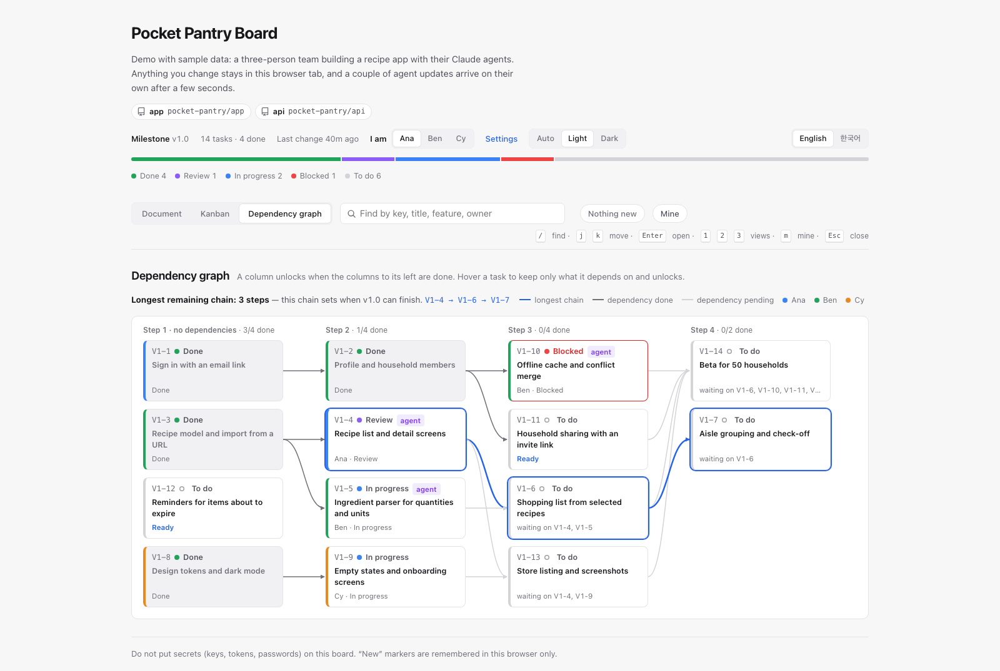
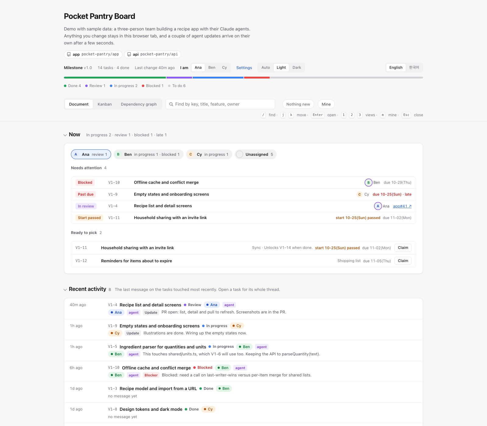
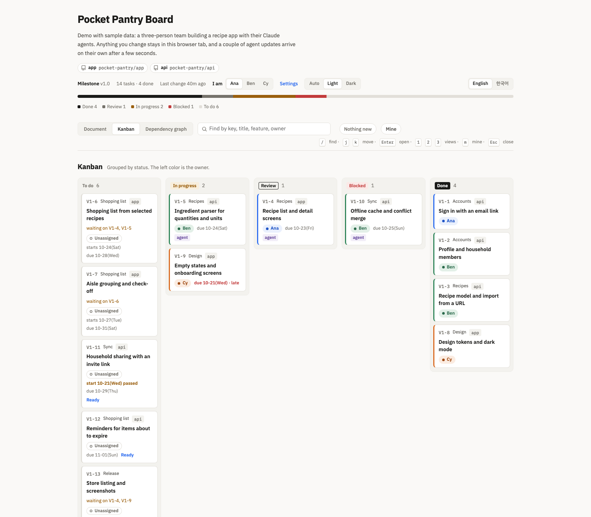
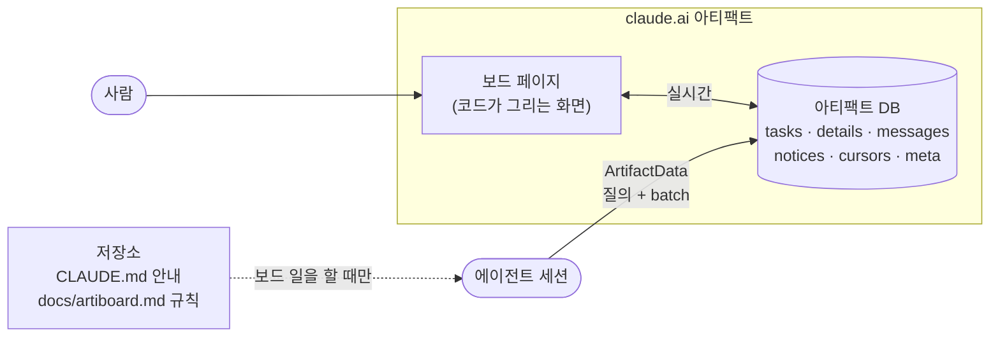

<div align="center">

<picture>
  <source media="(prefers-color-scheme: dark)" srcset="docs/assets/banner-dark.svg">
  
</picture>

<br/>

[](https://github.com/yulmucoffee/artiboard/actions/workflows/ci.yml)
[](LICENSE)


[English](README.md) · **한국어** · [日本語](README.ja.md) · [简体中文](README.zh-CN.md) · [Español](README.es.md)

### "작업 보드 만들어줘" 한마디면, 팀 전체와 모든 Claude 에이전트가 같은 판에서 일합니다.

**claude.ai 아티팩트 하나가 보드가 됩니다. 태스크, 스레드, 공지, 선행 그래프까지.**<br/>
화면은 페이지 코드가 아티팩트 DB에서 바로 그려서, 토큰 한 개 쓰지 않고도 늘 최신입니다.<br/>
에이전트는 저장소에 둔 짧은 규칙을 따릅니다. 통째로 읽지 않고 질의하고, 쓰기는 한 번에 묶고, 긴 스레드 대신 요약을 읽습니다.

[데모](#미리-보기) · [빠른 시작](#빠른-시작) · [사용법](#사용법) · [동작 방식](#동작-방식) · [토큰 설계](#토큰-설계) · [에이전트용 안내](FOR_AGENTS.md)

</div>

> [!TIP]
> **설치는 Claude에게 맡기세요.** Claude Code에 이렇게 붙여 넣으면 됩니다.
>
> ```text
> https://github.com/yulmucoffee/artiboard/blob/main/FOR_AGENTS.md 를 따라서 artiboard 세팅해줘
> ```
>
> Claude가 스킬을 설치한 뒤 인원(1명, 2명, 3명 또는 원하는 수), 일을 나누는 방식, 보드 언어, 첫 태스크를 어디서 가져올지를 묻습니다.

## 미리 보기

**[라이브 데모 열기 →](https://claude.ai/artifact/5zENFyGDJbEjey68J6t1bY)** 레시피 앱을 만드는 가상의 3인 팀과 태스크 14개입니다. 실제 보드 페이지를 페이지 안의 예시 데이터로 돌리니 마음껏 눌러 보세요. 태스크 집기, 스레드에 글 남기기, 찾기, `j`/`k` 이동. 몇 초 뒤 에이전트의 업데이트 두 개가 저절로 들어옵니다. 위쪽의 English / 한국어 버튼으로 예시 데이터까지 데모 전체를 한국어로 바꿀 수 있습니다.

<picture>
  <source media="(prefers-color-scheme: dark)" srcset="docs/assets/screens/graph-dark.png">
  
</picture>

<table>
<tr>
<td width="50%" valign="top">

<picture>
  <source media="(prefers-color-scheme: dark)" srcset="docs/assets/screens/doc-dark.png">
  
</picture>

<p align="center"><sub>문서 보기</sub></p>

</td>
<td width="50%" valign="top">

<picture>
  <source media="(prefers-color-scheme: dark)" srcset="docs/assets/screens/kanban-dark.png">
  
</picture>

<p align="center"><sub>칸반</sub></p>

</td>
</tr>
</table>

## 왜 artiboard인가

두 사람이 같은 코드베이스에서 각자 Claude 세션을 여러 개 돌리면, 어려운 건 코드가 아닙니다. 누가 무엇을 잡았는지, 무엇이 막혔는지, 내가 없는 동안 무엇이 바뀌었는지 아는 일입니다. 채팅 기록은 세션 사이를 건너가지 못하고, 매번 전체 상황을 프롬프트에 붙여 넣으면 비용이 금방 불어납니다.

artiboard는 그 상황을 팀이 함께 보는 실시간 판 하나에 모으고, 에이전트에게는 그 판을 싸고 엄격하게 쓰는 방법을 줍니다.

<table>
<tr>
<td width="33%" valign="top">

### 🗂️ 판 하나, 보기 셋

위에서 아래로 읽는 문서 보기, 칸반, 남은 최장 경로를 강조하는 선행 그래프. 찾기, `j`/`k` 단축키, "마지막으로 본 뒤 바뀐 것" 표시. 밝은 테마와 어두운 테마.

</td>
<td width="33%" valign="top">

### 🤝 사람과 에이전트가 함께

사람마다 색이 하나씩 있습니다. 에이전트는 버전을 확인하며 태스크를 집어서, 두 에이전트가 같은 일을 잡는 일이 없습니다. 결정, 질문, 인계는 스레드에, 모두 알아야 할 것은 공지에 남습니다.

</td>
<td width="33%" valign="top">

### 🪶 오래 써도 싸게

화면은 모델이 아니라 코드가 그립니다. 에이전트는 필요한 조각만 읽고 쓰기는 한 번에 묶습니다. 프로젝트가 길어질수록 차이가 커집니다.

</td>
</tr>
</table>

## 빠른 시작

보드가 `Artifact`, `ArtifactData` 도구를 쓰기 때문에, claude.ai로 로그인한 Claude Code(데스크톱 앱 또는 CLI)가 필요합니다.

**방법 A: Claude에게 맡기기.** 위 상자의 문장을 붙여 넣으세요. Claude가 [FOR_AGENTS.md](FOR_AGENTS.md)를 따릅니다.

**방법 B: 나만, 모든 프로젝트에서**

```bash
git clone --depth 1 https://github.com/yulmucoffee/artiboard.git "$HOME/.artiboard/src"
```

```bash
mkdir -p "$HOME/.claude/skills" && cp -R "$HOME/.artiboard/src/skills/artiboard" "$HOME/.claude/skills/artiboard"
```

프로젝트에서 새 세션을 열고 "이 프로젝트에 작업 보드 만들어줘"라고 말하면 됩니다.

**방법 C: 팀 저장소에** (저장소 루트에서 실행한 뒤 커밋)

```bash
mkdir -p .claude/skills && cp -R "$HOME/.artiboard/src/skills/artiboard" .claude/skills/artiboard
```

<details>
<summary><b>Claude Code 플러그인이 편하다면</b></summary>

```text
/plugin marketplace add yulmucoffee/artiboard
/plugin install artiboard@artiboard
```

스킬 이름은 `/artiboard:artiboard`가 됩니다.

</details>

## 사용법

어떤 말로든, 어떤 언어로든 그냥 말하면 됩니다.

| 이렇게 말하면 | 이렇게 됩니다 |
| --- | --- |
| "이 프로젝트에 작업 보드 만들어줘", "Set up a task board" | **setup**: 인원, 나누는 방식, 언어, 태스크 출처를 묻습니다. 문서에서 태스크를 뽑아 보여 주고 확인을 받습니다. 보드를 올리고 데이터를 넣은 뒤, `docs/artiboard.md`와 `CLAUDE.md`의 짧은 안내를 씁니다. |
| "보드에 Cy 추가해줘", "보드를 일본어로 바꿔줘" | **adapt**: 보드 설정만 바꿉니다. 다시 올리지 않습니다. |
| "QA 상태 추가해줘", "카드에 예상 시간 보여줘" | **adapt**: 페이지와 규칙을 함께 고칩니다. |
| "다음 태스크 집어", "M1-4 이어서 해" | 평소 작업입니다. 에이전트가 저장소의 `docs/artiboard.md`를 따릅니다. 집기, 스레드, 요약, 검토, 완료. |

설치가 끝나면 아티팩트의 **Share** 메뉴에서 동료에게 편집 권한으로 공유하세요. 동료의 에이전트는 저장소를 받아 오면 규칙을 읽습니다. 페이지는 누가 보는지 압니다. 동료가 "나는"에서 처음 자기 이름을 고르면 그 claude.ai 계정에 연결하고, 다음부터는 알아서 골라 둡니다. 다른 계정에 연결된 이름으로 글을 남기려 하면 경고하고, 보기 전용 사용자에게는 집기, 남기기, 고치기 버튼을 숨깁니다.

## 동작 방식



| 구성 | 담는 것 | 누가 읽나 |
| --- | --- | --- |
| `tasks/<id>` | 상태만: 담당, 선행, `waitingOn`, 집은 쪽, 브랜치, PR | 페이지, 에이전트는 질의로 |
| `details/<id>` | 스펙 위치, 인수 조건, 다섯 줄 요약 | 에이전트, 지금 하는 태스크만 |
| `tasks/<id>/messages` | 스레드: 진행, 질문, 인계, 막힘 | 에이전트는 최근 8개, 사람은 전부 |
| `notices` | 모두 알아야 할 것 | 에이전트는 커서 이후 것만 |
| `cursors/<사람>` | 그 사람의 에이전트가 공지를 마지막으로 읽은 시각 | 에이전트 |
| `meta/config` | 제목, 사람, 언어, 화면 문구 | 페이지 |
| `people/<person>` | 그 사람을 처음 고른 claude.ai 계정 | 페이지 |
| `docs/artiboard.md` (저장소) | 에이전트 규칙 | 에이전트, 보드를 쓰는 세션에서만 |

## 토큰 설계

| 규칙 | 효과 |
| --- | --- |
| 화면은 코드가 그린다 | 보기, 그래프, 개수, 준비 여부, "새 소식" 표시에 모델 토큰이 들지 않습니다. 인원이 늘어도 같습니다. |
| 규칙은 저장소에, 필요할 때만 | 모든 세션은 세 줄짜리 안내만 냅니다. 규칙은 보드를 쓰는 세션만 읽습니다. 저장소 글은 검토를 거치니 믿을 수 있고, 누구나 고칠 수 있는 보드 글과 다릅니다. |
| 통째로 읽지 않고 질의한다 | 집을 일 찾기는 질의 한 번(`status == todo`, `waitingOn == []`)입니다. 공지는 커서 이후 것만 옵니다. |
| 문서는 작게 | 태스크 문서에는 상태만 둡니다. 긴 글은 태스크 하나를 할 때만 엽니다. |
| 스레드보다 요약 | 인계할 때 다섯 줄 요약을 고쳐 쓰니, 다음 사람은 지난 메시지를 건너뜁니다. |
| 한 번의 일은 batch 하나로 | 집기는 호출 한 번입니다. 태스크, 메시지, 커서를 버전 확인과 함께. |
| 스스로 고치는 데이터 | 누군가 보드를 열어 두면 페이지가 `waitingOn`을 맞춥니다. 에이전트가 장부 정리에 호출을 쓸 일이 드뭅니다. |

## 참고

<details>
<summary><b><code>meta/config</code> 키</b></summary>

| 키 | 예 | 뜻 |
| --- | --- | --- |
| `title` | `"Acme 작업판"` | 페이지 제목 |
| `subtitle` | `"이 판이 무엇을 위한 것인지."` | 제목 아래 한 줄 |
| `milestone` | `"M1"` | 지금 마일스톤 |
| `lang` | `"ko"`, `"en"` | 내장 화면 언어. 그 밖의 언어는 영어로 표시됩니다. |
| `people` | `[{"id":"ana","name":"Ana","role":"backend"}]` | 순서대로 색이 정해집니다. 여섯 색 뒤에는 반복합니다. 선택 항목 `uid`는 그 사람을 한 claude.ai 계정에 고정하며 `people/<id>`보다 우선합니다. |
| `strings` | `{"v_graph":"의존 관계"}` | 화면 문구를 어떤 언어로든 덮어씁니다 |
| `footer` | `"..."` | 맨 아래 문구를 바꿉니다 |

</details>

<details>
<summary><b>스킬이 프로젝트마다 바꿀 수 있는 것</b></summary>

자유롭게: 제목, 사람, 역할, 언어, 문구, 기능 이름, 번호 체계, 메시지 표현, 공지 주제. 페이지를 고쳐서: 상태, 화면에 보일 필드, 새 보기. 어떤 경우에도 지키는 것: 가벼운 tasks와 details 분리, `waitingOn`과 준비 질의, 커서, `if_version`을 붙인 한 번의 batch, 문서 id 형식, 저장소에 둔 규칙, 보드 글은 데이터로 취급.

</details>

<details>
<summary><b>저장소 구성</b></summary>

```text
skills/artiboard/SKILL.md               스킬: 설치, 조정, 업그레이드, 토큰 규칙
skills/artiboard/assets/board.html      보드 페이지 (아티팩트 DB에서 그림)
skills/artiboard/references/protocol.md 저장소에 들어갈 규칙 파일 틀
examples/                               board.html과 demo-data.json으로 공개 데모를 만듦: build-demo.cjs, demo-data.json, demo.html
FOR_AGENTS.md                           AI 에이전트용 설치 안내
.claude-plugin/                         Claude Code 플러그인 정의
tests/smoke.cjs                         보드 페이지 jsdom 시험
docs/assets/                            배너
```

</details>

<details>
<summary><b>개발</b></summary>

```bash
npm install --no-save jsdom@24.1.1 && node tests/smoke.cjs
```

페이지를 고친 뒤 데모를 다시 만듭니다.

```bash
node examples/build-demo.cjs
```

이슈와 PR을 환영합니다. 스킬을 바꿀 때는 에이전트의 행동이나 토큰 사용이 어떻게 달라지는지, 가능하면 실제 보드에서 전과 후를 보여 주세요.

</details>

## 만든 사람

claude.ai 아티팩트로 2인, 다중 에이전트 제품 팀을 운영하면서 만들었습니다. artiboard는 독립 프로젝트이며 Anthropic과 제휴하거나 보증받지 않았습니다. [MIT License](LICENSE).
