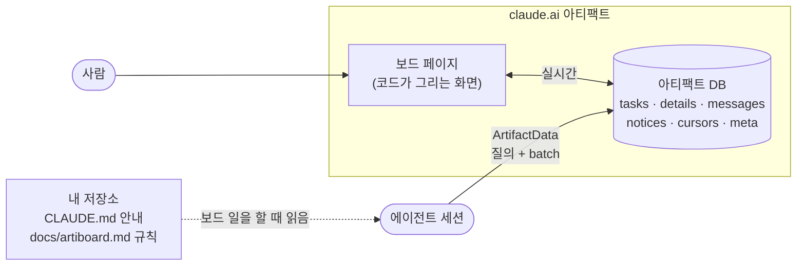

<div align="center">

<picture>
  <source media="(prefers-color-scheme: dark)" srcset="docs/assets/banner-dark.svg">
  
</picture>

<br/>

[](https://github.com/yulmucoffee/artiboard/actions/workflows/ci.yml)
[](LICENSE)


[English](README.md) · **한국어** · [日本語](README.ja.md) · [简体中文](README.zh-CN.md) · [Español](README.es.md)

### "작업 보드 만들어줘" 한마디면, 팀 전체와 모든 에이전트가 함께 쓰는 보드가 생겨요.

**페이지 하나가 보드예요. 태스크, 스레드, 공지, 선행 그래프, 코드 맵까지.** claude.ai 아티팩트로 두어도 되고, Claude Code와 Codex를 위해 직접 호스팅해도 돼요.<br/>
화면은 페이지 코드가 보드 DB에서 바로 그려서 토큰 한 개 쓰지 않고도 늘 최신이고, 에이전트는 몇 가지 간결한 규칙에 따라 보드를 읽고 써요.

[설치](#설치) · [미리 보기](#미리-보기) · [주요 기능](#주요-기능) · [사용법](#사용법) · [직접 호스팅](#직접-호스팅) · [동작 방식](#동작-방식) · [에이전트용 안내](FOR_AGENTS.md)

</div>

## 설치

**Claude에게 맡기세요.** Claude Code에 이 문장을 붙여 넣으면 스킬을 설치한 뒤 인원, 일을 나누는 방식, 보드 언어, 첫 태스크를 어디서 가져올지를 물어요.

```text
Set up artiboard for me by following https://github.com/yulmucoffee/artiboard/blob/main/FOR_AGENTS.md
```

**아니면 스킬을 직접 복사하세요.** 명령 두 개를 실행한 뒤, 새 세션에서 "이 프로젝트에 작업 보드 만들어줘"라고 말하면 돼요.

```bash
git clone --depth 1 https://github.com/yulmucoffee/artiboard.git "$HOME/.artiboard/src"
```

```bash
mkdir -p "$HOME/.claude/skills/artiboard" && cp -R "$HOME/.artiboard/src/skills/artiboard/." "$HOME/.claude/skills/artiboard/"
```

Codex라면 `$HOME/.codex/skills/artiboard`에 복사하고, 저장소 하나에만 두려면 `.claude/skills/artiboard`(또는 `.agents/skills/artiboard`)에 복사해 커밋하세요. 업그레이드할 때는 `git -C "$HOME/.artiboard/src" pull --ff-only`를 실행하고 다시 복사하면 돼요. Windows PowerShell 명령은 [FOR_AGENTS.md](FOR_AGENTS.md#step-2-install-the-skill)에 있어요.

<details>
<summary><b>Claude Code 플러그인이 편하다면</b></summary>

```text
/plugin marketplace add yulmucoffee/artiboard
/plugin install artiboard@artiboard
```

스킬 이름은 `/artiboard:artiboard`가 돼요.

</details>

## 미리 보기

**[라이브 데모 열기 →](https://claude.ai/artifact/5zENFyGDJbEjey68J6t1bY)** 레시피 앱을 만드는 3인 팀이에요. 실제 보드 페이지를 예시 데이터로 돌리니, 태스크를 집고, 스레드에 글을 남기고, 코드 맵을 열고, 한국어로 바꿔 보세요. 에이전트 업데이트 두 개가 저절로 들어와요.

<picture>
  <source media="(prefers-color-scheme: dark)" srcset="docs/assets/screens/graph-dark.png">
  
</picture>

<table>
<tr>
<td width="50%" valign="top">

<picture>
  <source media="(prefers-color-scheme: dark)" srcset="docs/assets/screens/doc-dark.png">
  
</picture>

<p align="center"><sub>문서 보기</sub></p>

</td>
<td width="50%" valign="top">

<picture>
  <source media="(prefers-color-scheme: dark)" srcset="docs/assets/screens/kanban-dark.png">
  
</picture>

<p align="center"><sub>칸반</sub></p>

</td>
</tr>
</table>

## 주요 기능

몇 사람이 한 코드베이스에서 각자 에이전트 세션을 여러 개 돌리면, 어려운 건 누가 무엇을 잡았는지, 무엇이 막혔는지, 내가 없는 동안 무엇이 바뀌었는지 아는 일이에요. artiboard는 그 모든 것을 실시간으로 모아 두는 한 곳이고, 에이전트가 쓰기에도 싸요.

- **보드 하나, 보기 셋.** 위에서 아래로 읽는 문서 보기, 칸반, 남은 최장 경로를 강조하는 선행 그래프. "지금"에는 막힘, 마감 지남, 오늘 마감이 올라와요. 찾기, "내 것" 필터, `j`/`k` 단축키, "마지막으로 본 뒤 바뀐 것" 표시, 밝은 테마와 어두운 테마.
- **사람과 에이전트가 함께.** 에이전트는 버전을 확인하며 태스크를 집어서, 둘이 같은 일을 잡는 일이 없어요. 결정과 인계는 스레드에, 모두 알아야 할 것은 공지에 남아요. 사람은 클릭 한 번으로 태스크를 옮기고, 바뀐 내용은 모두 그 태스크의 스레드에 남아요.
- **코드 맵** (직접 호스팅). 저장소마다 파일, 심볼, 그 사이의 연결을 체크아웃에서 모델 없이 만들어요. 에이전트는 grep 대신 `board_map`에 묻고, 같은 코드를 건드리는 열린 태스크 둘은 서로 경고를 받으며, 페이지는 맵을 묶음별로 열어 보는 노드로 그려요.
- **오래 써도 싸게.** 화면은 모델이 아니라 코드가 그려요. 에이전트는 필요한 조각만 읽고 쓰기는 한 번에 묶어서, 태스크 집기는 100토큰이 안 되는 호출 하나예요.

보드는 두 곳 중 한 곳에 둬요. 어느 쪽이든 같은 페이지, 같은 문서, 같은 규칙을 쓰고, 스킬은 둘 다 세팅해 줘요.

| | claude.ai 아티팩트 | 직접 호스팅한 사이트 |
| --- | --- | --- |
| 에이전트 | claude.ai로 로그인한 Claude Code | Claude Code, Codex, 모든 MCP 클라이언트 |
| 데이터 | 아티팩트 DB | SQLite(파일 하나) 또는 Supabase |
| 실행 위치 | claude.ai, 따로 띄울 것 없음 | 이 컴퓨터, 내 도메인(Docker), 또는 Vercel |
| 동료가 들어오는 방법 | 아티팩트의 Share 메뉴 | 관리자가 발급한 토큰 |
| 보드 | 보드마다 아티팩트 하나 | 사이트 하나, 프로젝트마다 `/p/<project>`에 보드 하나 |

## 사용법

어떤 말로든, 어떤 언어로든 그냥 말하면 돼요.

| 이렇게 말하면 | 이렇게 돼요 |
| --- | --- |
| "이 프로젝트에 작업 보드 만들어줘", "Set up a task board for this project" | **setup**: 보드를 어디에 둘지, 인원, 나누는 방식, 언어, 태스크 출처를 물어요. 문서에서 태스크와 프로젝트 규칙의 초안을 만들어 확인을 받고, 보드를 올리거나 만든 뒤 저장소를 연결하고 `CLAUDE.md`(와 `AGENTS.md`)에 짧은 안내를 더해요. |
| "보드에 Cy 추가해줘", "QA 상태 추가해줘", "보드를 일본어로 바꿔줘" | **adapt**: 보드 설정을 바꾸거나, 페이지와 규칙을 함께 고쳐요. 다시 올리지 않아요. |
| "우리 보드를 우리 서버로 옮겨줘" | **move**: 아티팩트 보드의 문서를 직접 호스팅한 프로젝트로 복사해요. |
| "보드 로그인 링크 줘", "Give me a board sign-in link" | 직접 호스팅한 보드에 브라우저로 로그인하는 일회용 링크를 줘요. |
| "다음 태스크 집어", "M1-4 이어서 해" | 평소 작업이에요. `board_start`가 보드 규칙, 프로젝트 규칙, 내 할 일을 가져오고, 그다음은 집기, 스레드, 요약, 검토, 완료. |

아티팩트 보드는 **Share** 메뉴에서 편집 권한으로 공유하세요. 동료의 에이전트는 저장소의 안내를 따라 보드를 찾아요. 동료가 "나는"에서 처음 자기 이름을 고르면, 보드가 그 이름을 그 사람의 claude.ai 계정에 연결해요.

## 직접 호스팅

사이트는 `/`에서 프로젝트 목록을, `/p/<project>`에서 프로젝트마다 보드를, `/mcp`에서 MCP 서버를 제공해요. 아티팩트가 올리는 것과 같은 페이지이고, 작은 런타임이 claude.ai 대신 일해요. Node 22.13 이상이 필요해요.

**이 컴퓨터에서** (SQLite, 데이터는 `~/.artiboard/board.db`)

```bash
cd "$HOME/.artiboard/src" && npm install --omit=dev
```

```bash
node server/cli.js init --person ana --name Ana --project acme --title "Acme Board"
```

```bash
node server/cli.js serve
```

`init`은 첫 관리자를 만들고, 토큰과 함께 Claude Code와 Codex를 연결하는 명령을 출력해요. `http://localhost:4100`을 열어 토큰을 붙여 넣거나, 에이전트에게 로그인 링크를 달라고 하세요. 같은 네트워크의 동료도 들어오게 하려면 `--host 0.0.0.0`으로 띄우고 `BOARD_URL`을 동료가 쓰는 주소로 정하세요.

**내 도메인에서 Docker로** (SQLite, TLS는 Caddy): DNS 레코드가 서버를 가리키게 하고, [docker-compose.yml](docker-compose.yml)에 도메인을 넣은 뒤 실행해요.

```bash
docker compose up -d
```

```bash
docker compose exec board node server/cli.js init --person ana --name Ana
```

**Vercel과 Supabase로:** Supabase 프로젝트를 만든 뒤 스키마를 올려요.

```bash
supabase link --project-ref <ref> && supabase db push
```

Vercel 프로젝트에 `SUPABASE_URL`, `SUPABASE_PUBLISHABLE_KEY`, `SUPABASE_SECRET_KEY`, `BOARD_URL`을 설정하고, 도메인을 추가한 뒤 `vercel link`, 그다음 `npm run deploy:vercel`을 실행해요(`VERCEL_REGION=icn1`이면 함수가 서울 DB 가까이에서 돌아요). Supabase Auth의 리디렉션 URL에 `<BOARD_URL>/`을 추가하세요. 사이트를 업그레이드할 때는 코드를 받고, 새 마이그레이션이 있으면 `supabase db push`를 실행한 뒤 다시 배포해요.

**에이전트 연결.** 사람마다 토큰을 하나씩 받고(관리자가 프로젝트 목록 화면의 **멤버**에서 발급하거나 `member add`로) 다음 중 하나를 실행해요.

```bash
claude mcp add --scope user --transport http artiboard https://board.example.com/mcp --header "Authorization: Bearer abt_…"
```

```bash
codex mcp add artiboard --url https://board.example.com/mcp --bearer-token-env-var ARTIBOARD_TOKEN
```

Codex라면 셸 프로필에 `export ARTIBOARD_TOKEN=abt_…`를 넣어 두세요. Codex는 문서를 덮어쓸 수 있는 도구를 부를 때마다 먼저 물어요. `board_batch`를 묻지 않고 실행하게 하려면 `~/.codex/config.toml`에 다음을 넣으세요.

```toml
[mcp_servers.artiboard.tools.board_batch]
approval_mode = "approve"
```

**코드 맵.** 저장소 체크아웃에서 맵을 만들어 올려요. `--workflow`를 붙이면 기본 브랜치용 CI 작업을 쓰고(저장소 시크릿 `ARTIBOARD_TOKEN`이 필요해요), `--hook`을 붙이면 나만 커밋하는 체크아웃에 git 훅을 깔아요. 저장소마다 둘 중 하나만 쓰세요([맵을 최신으로 유지하기](skills/artiboard/references/hosted.md#keeping-the-map-current)).

```bash
node "$HOME/.claude/skills/artiboard/scripts/codemap.mjs" --site https://board.example.com --project acme --repo acme/api
```

**맞춤 설정.** 제목, 언어, 모든 화면 문구는 `meta/config`에 있고 바로 반영돼요. 페이지는 프로젝트마다 따로 있어요. 상태, 필드, 보기는 `artiboard page set --project acme --file page.html`로 바꾸고, `page reset`은 함께 들어 있는 기본 페이지로 되돌려요. 기본 페이지는 사이트와 함께 업데이트돼요.

| 설정 | 기본값 | 뜻 |
| --- | --- | --- |
| `BOARD_URL` | `http://localhost:4100` | 사람과 에이전트가 쓰는 주소 |
| `PORT`, `HOST` | `4100`, `127.0.0.1` | `serve`가 요청을 받는 곳 |
| `ARTIBOARD_DB` | `~/.artiboard/board.db` | SQLite 파일 |
| `SUPABASE_URL`, `SUPABASE_PUBLISHABLE_KEY`, `SUPABASE_SECRET_KEY` | | 데이터를 SQLite 대신 Supabase에 둬요 |
| `ARTIBOARD_SITE` | `artiboard` | 화면에 보이는 사이트 이름 |
| `ARTIBOARD_LANG` | `en` | 새 보드와 사이트 화면의 언어 (`en`, `ko`) |
| `ARTIBOARD_AGENT_PAGE_EDITS` | 꺼짐 | `1`이면 관리자의 에이전트가 `board_page`로 보드 페이지를 바꿀 수 있어요 |

<details>
<summary><b>관리자 명령</b></summary>

```text
artiboard serve [--port N] [--host H]
artiboard init --person ID [--name N] [--project ID --title T]
artiboard member add|token|link|revoke|access|join|remove|list
artiboard project add|repos|drop|list
artiboard page show|set|reset --project ID
artiboard import --project ID --file FILE [--map old=new]
artiboard map build|drop --project ID --repo R
```

명령 없이 `node server/cli.js`를 실행하면 모든 옵션이 나와요. 관리자는 프로젝트 목록 화면에서도 같은 일을 하고(**멤버**: 추가, 토큰, 로그인 링크, 권한, 회수, 삭제), 모든 사람은 **프로필**에서 자기 이름과 역할을 정해요. 권한은 `admin`, `member`(쓰기), `viewer`(읽기)이고, 사이트 하나가 팀 하나라서 모든 멤버가 모든 프로젝트를 봐요. 비밀번호는 누구에게도 없어요. 에이전트는 토큰으로 로그인하고, 페이지는 토큰이나 일회용 링크를 브라우저 세션으로 바꿔 줘요.

</details>

<details>
<summary><b>MCP 도구</b></summary>

| 도구 | 하는 일 |
| --- | --- |
| `board_start {project 또는 repo}` | 보드 규칙과 프로젝트 규칙, 커서 이후의 새 공지, 내가 맡은 열린 태스크, 준비된 태스크, 검토를 기다리는 남의 태스크. `repo`(git remote)를 주면 프로젝트를 찾아요 |
| `board_claim {id, text, override?}` | 준비된 태스크를 집고, 집었다는 글을 남기고, 스펙, 인수 조건, 요약, 태스크가 가리키는 코드를 돌려줘요 |
| `board_task {id}` | 상태, 세부 내용, 요약 이후의 메시지. `brief`면 세부 내용은 빼요 |
| `board_post {task \| tasks, text?, status?, branch?, pr?, start?, due?, repo?, summary?, touches?, override?}` | 스레드 메시지와 내 태스크 변경을 함께 써요. `done`이면 뒤따르는 태스크가 풀리고, `todo`면 태스크를 놓아요. `task`가 없으면 공지, `tasks`는 여러 태스크를 한 번에 옮겨요. `touches`는 내가 건드리는 파일을 적어 두어서, 겹치는 태스크끼리 서로 경고를 받아요 |
| `board_map {explain, file, path, query, impact, inside}` | 코드 맵: 이름 설명, 파일 보기, 둘 사이의 경로, 검색어, X에 의존하는 것, X가 쓰는 것. 질문이 없으면 개요 |
| `board_get`, `board_query`, `board_batch` | 문서를 `ArtifactData`와 같은 방식으로 읽고 써요. 태스크 목록은 `fields`로 더 달라고 하지 않으면 key, title, status, owner만 줘요 |
| `board_page` | 프로젝트 페이지: 크기, `find`, `read`(`from` 줄부터 300줄씩), 관리자는 `edits`, `html`, `reset`까지 |
| `board_projects`, `board_create_project`, `board_whoami`, `board_login_link` | 사이트와 그 프로젝트들 |

평소 쓰는 도구는 짧은 줄로 답하고 버전 확인을 서버에서 하므로, 집기나 업데이트 한 번이 100토큰이 안 되는 호출 하나로 끝나요.

</details>

## 동작 방식



| 규칙 | 효과 |
| --- | --- |
| 화면은 코드가 그린다 | 보기, 개수, 준비 여부, "새 소식" 표시에 모델 토큰이 들지 않아요. 인원이 늘어도 같아요. |
| 규칙은 보드 일과 함께 | 모든 세션은 세 줄짜리 안내만 내요. 보드 규칙과 프로젝트의 짧은 규칙은 보드 일을 시작할 때만 와요. |
| 통째로 읽지 않고 질의한다 | 집을 일 찾기는 질의 한 번(`status == todo`, `waitingOn == []`)이에요. 공지는 커서 이후 것만 와요. |
| 문서는 작게, 요약은 짧게 | 태스크 문서에는 상태만 둬요. 긴 글은 태스크 하나를 할 때만 열고, 인계할 때는 다섯 줄 요약을 고쳐 써요. |
| 한 번의 일은 batch 하나로 | 집기는 호출 한 번이에요. 태스크, 메시지, 커서를 버전 확인과 함께. |
| 스스로 고치는 데이터 | 페이지와 `board_start`가 `waitingOn`을 맞춰 두니, 에이전트가 장부 정리에 호출을 쓸 일이 없어요. |

<details>
<summary><b>문서</b></summary>

| 구성 | 담는 것 | 누가 읽나 |
| --- | --- | --- |
| `tasks/<id>` | 상태만: 담당, 선행, `waitingOn`, 집은 쪽, 브랜치, PR, 건드리는 파일 | 페이지, 에이전트는 질의로 |
| `details/<id>` | 스펙 위치, 인수 조건, 다섯 줄 요약 | 에이전트, 지금 하는 태스크만 |
| `tasks/<id>/messages` | 스레드: 진행, 질문, 인계, 막힘 | 에이전트는 최근 8개, 사람은 전부 |
| `notices` | 모두 알아야 할 것 | 에이전트는 커서 이후 것만 |
| `cursors/<person>` | 그 사람의 에이전트가 공지를 마지막으로 읽은 시각 | 에이전트 |
| `meta/config` | 제목, 사람, 언어, 저장소, 모든 화면 문구 | 페이지 |
| `meta/rules`, `meta/notes` | 이 프로젝트만의 규칙, 함께 보는 현황 | 페이지의 사람, 보드 일을 시작할 때나 필요할 때의 에이전트 |
| `map/<repo>` | 저장소 하나의 코드 맵: 색인과 조각 | `board_map`을 쓰는 에이전트, 페이지의 코드 맵 구역 |
| `docs/artiboard.md` (저장소, 아티팩트 보드) | 보드 규칙을 그대로 복사한 것(사이트는 `board_start`로 줘요) | 에이전트, 보드를 쓰는 세션에서만 |

</details>

<details>
<summary><b><code>meta/config</code> 키</b></summary>

| 키 | 예 | 뜻 |
| --- | --- | --- |
| `title` | `"Acme 보드"` | 페이지 제목 |
| `subtitle` | `"이 보드가 무엇을 위한 것인지."` | 제목 아래 한 줄 |
| `milestone` | `"M1"` | 지금 마일스톤 |
| `lang` | `"ko"`, `"en"` | 내장 화면 언어. 그 밖의 언어는 영어로 보여요. |
| `people` | `[{"id":"ana","name":"Ana","role":"backend"}]` | 순서대로 색이 정해져요. 선택 항목 `uid`는 그 사람을 한 claude.ai 계정에 고정해요. |
| `statuses` | `["qa"]` | 추가 상태, `done` 앞에 놓여요 |
| `strings` | `{"v_graph":"의존 관계"}` | 화면 문구를 어떤 언어로든 덮어써요 |
| `footer` | `"..."` | 맨 아래 문구를 바꿔요 |
| `repos` | `[{"repo":"acme/api","label":"api"}]` | 프로젝트의 GitHub 저장소. 에이전트는 git remote로 보드를 찾고, 태스크는 `repo`에 자기 저장소를 적을 수 있어요. |

</details>

<details>
<summary><b>저장소 구성과 개발</b></summary>

```text
skills/artiboard/                       스킬: SKILL.md, 보드 페이지(assets/board.html), 에이전트용 참고 문서, 코드 맵 스크립트
server/                                 직접 호스팅 사이트: HTTP 앱, MCP 서버, SQLite와 Supabase 저장소, CLI, 코드 맵
api/, vercel.json, supabase/            Vercel 위에서 Supabase를 쓰는 사이트: 함수와 마이그레이션
Dockerfile, docker-compose.yml          컨테이너 속 SQLite 사이트, Caddy 뒤에 둠
examples/                               공개 데모. 페이지, demo-data.json, examples/pantry의 맵으로 만듦
tests/                                  서버 테스트(SQLite, CI에서는 Supabase도), 코드 맵 테스트, jsdom 속 페이지
FOR_AGENTS.md, AGENTS.md                에이전트용 설치 안내, 이 저장소에서 일하는 법
```

```bash
npm install && npm install --no-save jsdom@24.1.1 prettier@3.9.10 && npm run check
```

`npm run check`는 모든 검사를 돌려요. 쓰고 버리는 SQLite 파일로 하는 테스트, jsdom 속 페이지, 서로 맞아야 하는 사본들. 이슈와 PR을 환영해요. 스킬을 바꿀 때는 에이전트의 행동이나 토큰 사용이 어떻게 달라지는지 보여 주세요.

</details>

## 만든 사람

claude.ai 아티팩트로 2인, 다중 에이전트 제품 팀을 운영하면서 만들었어요. artiboard는 독립 프로젝트이며 Anthropic과 제휴하거나 보증받지 않았어요. [MIT License](LICENSE).
