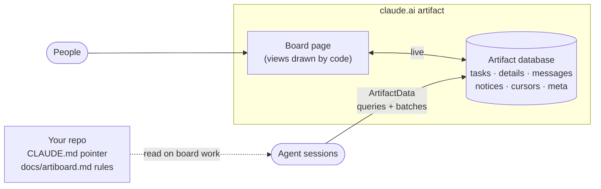

<div align="center">

<picture>
  <source media="(prefers-color-scheme: dark)" srcset="docs/assets/banner-dark.svg">
  
</picture>

<br/>

[](https://github.com/yulmucoffee/artiboard/actions/workflows/ci.yml)
[](LICENSE)


**English** · [한국어](README.ko.md) · [日本語](README.ja.md) · [简体中文](README.zh-CN.md) · [Español](README.es.md)

### Say "set up a task board". Get one board your whole team and every Claude agent work from.

**A single claude.ai artifact becomes the board: tasks, threads, notices and a dependency graph.**<br/>
The page draws everything from the artifact's database in code, so it stays live without spending a token.<br/>
Agents follow a few lean rules that live in your repo: query instead of list, one batch per action, summaries instead of long threads.

[Demo](#see-it) · [Quick start](#quick-start) · [Use it](#use-it) · [How it works](#how-it-works) · [Token design](#token-design) · [For agents](FOR_AGENTS.md)

</div>

> [!TIP]
> **Let Claude set it up.** Paste this into Claude Code:
>
> ```text
> Set up artiboard for me by following https://github.com/yulmucoffee/artiboard/blob/main/FOR_AGENTS.md
> ```
>
> Claude installs the skill, then asks how many people (1, 2, 3 or any number), how you split work, the board language and where the first tasks come from.

## See it

**[Open the live demo →](https://claude.ai/artifact/5zENFyGDJbEjey68J6t1bY)** A sample three-person team building a recipe app, with 14 tasks. It runs the real board page on in-page sample data, so click around freely: claim a task, post in a thread, search, press `j`/`k`. Two agent updates arrive on their own after a few seconds. The English / 한국어 toggle at the top switches the whole demo, sample data included, to Korean.

<picture>
  <source media="(prefers-color-scheme: dark)" srcset="docs/assets/screens/graph-dark.png">
  
</picture>

<table>
<tr>
<td width="50%" valign="top">

<picture>
  <source media="(prefers-color-scheme: dark)" srcset="docs/assets/screens/doc-dark.png">
  
</picture>

<p align="center"><sub>Document view</sub></p>

</td>
<td width="50%" valign="top">

<picture>
  <source media="(prefers-color-scheme: dark)" srcset="docs/assets/screens/kanban-dark.png">
  
</picture>

<p align="center"><sub>Kanban</sub></p>

</td>
</tr>
</table>

## Why artiboard

When two people each run a few Claude sessions on one codebase, the hard part is not the code. It is knowing who took what, what is blocked, and what changed while you were away. Chat logs do not travel between sessions, and pasting the whole state into every prompt gets expensive fast.

artiboard gives the team one shared, live place for that state, and gives agents a cheap, strict way to use it.

<table>
<tr>
<td width="33%" valign="top">

### 🗂️ One board, three views

A document view you read top to bottom, a kanban, and a dependency graph that highlights the longest remaining chain. Search, `j`/`k` keys and "new since you last looked" markers. Light and dark.

</td>
<td width="33%" valign="top">

### 🤝 People and agents together

Each person gets a color. Agents claim tasks with version-checked writes, so two agents never take the same task. Threads hold decisions, questions and handoffs. Notices carry what everyone must know.

</td>
<td width="33%" valign="top">

### 🪶 Built to stay cheap

Views are drawn by code, never by a model. Agents read only the slice they need and write in one batch. The longer the project runs, the more this matters.

</td>
</tr>
</table>

## Quick start

You need Claude Code signed in with claude.ai (the desktop app or the CLI), because the board uses the `Artifact` and `ArtifactData` tools.

**Option A: let Claude do it.** Use the prompt in the box above. Claude follows [FOR_AGENTS.md](FOR_AGENTS.md).

**Option B: just for me, in every project**

```bash
git clone --depth 1 https://github.com/yulmucoffee/artiboard.git "$HOME/.artiboard/src"
```

```bash
mkdir -p "$HOME/.claude/skills" && cp -R "$HOME/.artiboard/src/skills/artiboard" "$HOME/.claude/skills/artiboard"
```

Open a new session in your project and say "set up a task board for this project".

**Option C: for my team's repository** (run in the repository root, then commit)

```bash
mkdir -p .claude/skills && cp -R "$HOME/.artiboard/src/skills/artiboard" .claude/skills/artiboard
```

<details>
<summary><b>Prefer the Claude Code plugin?</b></summary>

```text
/plugin marketplace add yulmucoffee/artiboard
/plugin install artiboard@artiboard
```

The skill is then `/artiboard:artiboard`.

</details>

## Use it

Just ask, in any words and any language.

| You say | What happens |
| --- | --- |
| "Set up a task board for this project", "작업 보드 만들어줘" | **setup**: asks team size, split, language and task source. Drafts tasks from your docs and shows them for a yes. Publishes the board, seeds it, writes `docs/artiboard.md` and a short pointer in `CLAUDE.md`. |
| "Add Cy to the board", "Switch the board to Japanese" | **adapt**: updates the board's config. No republish. |
| "Add a QA status", "Show estimates on cards" | **adapt**: edits the page and the rules together. |
| "Pick the next task", "Continue M1-4" | Daily work. The agent follows `docs/artiboard.md` in your repo: claim, thread, summary, review, done. |

After setup, share the board with teammates from the artifact's **Share** menu with edit access. Their agents get the rules when they pull the repository. The page knows who is viewing: the first time a teammate picks their name under "I am", the board links it to their claude.ai account and picks it for them from then on. It warns when someone posts under a name linked to another account, and view-only viewers see the board without claim, post or edit controls.

## How it works



| Piece | What it holds | Who reads it |
| --- | --- | --- |
| `tasks/<id>` | Status only: owner, deps, `waitingOn`, claim, branch, PR | The page; agents through queries |
| `details/<id>` | Spec pointer, acceptance, a five-line summary | Agents, only for the task in hand |
| `tasks/<id>/messages` | The thread: updates, questions, handoffs, blockers | Agents read the last eight; people read all |
| `notices` | What everyone must know | Agents read only what is newer than their cursor |
| `cursors/<person>` | When that person's agents last read notices | Agents |
| `meta/config` | Title, people, language, any UI string | The page |
| `people/<person>` | Which claude.ai account picked that person first | The page |
| `docs/artiboard.md` (repo) | The agent rules | Agents, only in sessions that touch the board |

## Token design

| Rule | Effect |
| --- | --- |
| Code draws the board | Views, charts, counts, readiness and "new" markers cost zero model tokens, at any team size. |
| Rules live in the repo, loaded on demand | Every session pays for a three-line pointer. Only board sessions read the rules. Repo text is also trusted and reviewed, unlike board text anyone can edit. |
| Query, never list | Finding work is one query (`status == todo`, `waitingOn == []`). Notices come in as a delta after your cursor. |
| Small documents | Task documents hold status. Long text is opened for one task at a time. |
| Summaries over threads | Handoffs rewrite a five-line summary, so the next reader skips old messages. |
| One batch per action | A claim is one call: task, message and cursor together, version-checked. |
| Self-repairing data | The page keeps `waitingOn` right while anyone has it open, so agents rarely spend calls on bookkeeping. |

## Reference

<details>
<summary><b><code>meta/config</code> keys</b></summary>

| Key | Example | Meaning |
| --- | --- | --- |
| `title` | `"Acme Board"` | Heading on the page |
| `subtitle` | `"What this board is for."` | One line under the heading |
| `milestone` | `"M1"` | Current milestone label |
| `lang` | `"en"`, `"ko"` | Built-in UI language. Others fall back to English. |
| `people` | `[{"id":"ana","name":"Ana","role":"backend"}]` | Order sets colors. Six colors, then they repeat. An optional `uid` pins a person to one claude.ai account and wins over `people/<id>`. |
| `strings` | `{"v_graph":"Dependencies"}` | Override any UI string, in any language |
| `footer` | `"..."` | Replaces the footer line |

</details>

<details>
<summary><b>What the skill may change per project</b></summary>

Free: title, people, roles, language, labels, feature names, key scheme, message wording, notice topics. Through page edits: statuses, extra visible fields, new views. Kept in every adaptation: lean tasks plus details, `waitingOn` and the ready query, cursors, one batch per action with `if_version`, id formats, rules in the repo, board text treated as data.

</details>

<details>
<summary><b>Repository layout</b></summary>

```text
skills/artiboard/SKILL.md               the skill: setup, adapt, upgrade, token rules
skills/artiboard/assets/board.html      the board page (renders from the artifact database)
skills/artiboard/references/protocol.md template for the rules file installed into your repo
examples/                               builds the public demo from board.html and demo-data.json: build-demo.cjs, demo-data.json, demo.html
FOR_AGENTS.md                           step-by-step install for AI agents
.claude-plugin/                         Claude Code plugin manifests
tests/smoke.cjs                         jsdom smoke test of the board page
docs/assets/                            banners
```

</details>

<details>
<summary><b>Development</b></summary>

```bash
npm install --no-save jsdom@24.1.1 && node tests/smoke.cjs
```

Rebuild the demo after changing the page:

```bash
node examples/build-demo.cjs
```

Issues and PRs are welcome. For a change to the skill, show how agent behavior or token use changes, ideally before and after on a real board.

</details>

## Credits

Built while coordinating a two-person, multi-agent product team on claude.ai artifacts. artiboard is independent and not affiliated with or endorsed by Anthropic. [MIT License](LICENSE).
