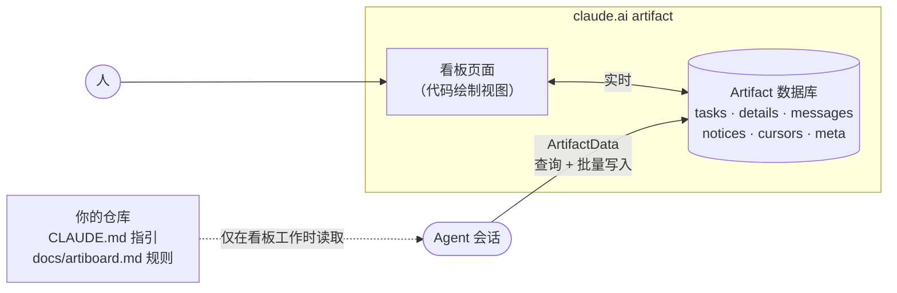

<div align="center">

<picture>
  <source media="(prefers-color-scheme: dark)" srcset="docs/assets/banner-dark.svg">
  
</picture>

<br/>

[](https://github.com/yulmucoffee/artiboard/actions/workflows/ci.yml)
[](LICENSE)


[English](README.md) · [한국어](README.ko.md) · [日本語](README.ja.md) · **简体中文** · [Español](README.es.md)

### 说一句"建一个任务看板"，整个团队和每个 agent 就在同一块看板上工作。

**一个页面就是看板：任务、讨论串、公告，还有依赖图。** 可以把它留作 claude.ai artifact，也可以自行托管，供 Claude Code 和 Codex 使用。<br/>
页面代码直接从看板的数据库绘制一切，所以无需花费任何 token 就始终是最新的。<br/>
Agent 遵循放在你仓库里的几条精简规则：用查询代替全量读取，每个动作一次批量写入，用摘要代替冗长的讨论串。

[演示](#演示) · [快速开始](#快速开始) · [使用](#使用) · [自托管](#自托管) · [工作原理](#工作原理) · [Token 设计](#token-设计) · [给 agent 的说明](FOR_AGENTS.md)

</div>

> [!TIP]
> **让 Claude 帮你安装。** 把下面这句粘贴到 Claude Code：
>
> ```text
> 按照 https://github.com/yulmucoffee/artiboard/blob/main/FOR_AGENTS.md 帮我安装 artiboard
> ```
>
> Claude 会先安装这个 skill，然后询问人数（1 人、2 人、3 人或任意人数）、分工方式、看板语言，以及第一批任务从哪里来。

## 演示

**[打开在线演示 →](https://claude.ai/artifact/5zENFyGDJbEjey68J6t1bY)** 一个正在开发菜谱应用的虚构三人团队，共 14 个任务。它用页面内的示例数据运行真实的看板页面，随便点：认领任务、在讨论串里留言、搜索、按 `j`/`k` 移动。几秒后会自动收到两条 agent 更新。顶部的 English / 한국어 按钮可以把整个演示（包括示例数据）切换成韩语。 在看板里可以折叠一列、以两列卡片显示，或把已完成的工作归档。

<picture>
  <source media="(prefers-color-scheme: dark)" srcset="docs/assets/screens/graph-dark.png">
  
</picture>

<table>
<tr>
<td width="50%" valign="top">

<picture>
  <source media="(prefers-color-scheme: dark)" srcset="docs/assets/screens/doc-dark.png">
  
</picture>

<p align="center"><sub>文档视图</sub></p>

</td>
<td width="50%" valign="top">

<picture>
  <source media="(prefers-color-scheme: dark)" srcset="docs/assets/screens/kanban-dark.png">
  
</picture>

<p align="center"><sub>看板</sub></p>

</td>
</tr>
</table>

## 为什么是 artiboard

当两个人在同一个代码库里各自运行好几个 Claude 会话时，难的不是代码，而是知道谁拿了什么、什么被卡住了、自己不在时发生了什么变化。聊天记录无法跨会话传递，而每次把全部状态贴进提示词，成本很快就会失控。

artiboard 把这些状态集中到团队共享的一块实时看板上，并给 agent 一套便宜而严格的使用方式。

<table>
<tr>
<td width="33%" valign="top">

### 🗂️ 一块看板，三种视图

从上往下读的文档视图、看板视图，以及突出最长剩余链路的依赖图。最近动态列出每个有动静的任务的最后一条消息，"当前"会突出被阻塞、已逾期或今天到期的任务。支持搜索、按列排序、"我的"筛选、`j`/`k` 快捷键和"上次查看后的变化"标记。浅色、深色或自动主题。 看板像 Notion 一样铺满窗口，列可以折叠或以两列卡片显示，堆积的已完成任务可一次归档。

</td>
<td width="33%" valign="top">

### 🤝 人与 agent 协同

每个人有自己的颜色。Agent 通过带版本校验的写入认领任务，两个 agent 不会抢到同一个任务。决定、问题和交接写在讨论串里，所有人都要知道的事写在公告里。 评审中的任务由评审人直接完成；别人负责的任务，只有在使用者明确要求时 agent 才会接手。人也能一键移动任务，每次改动都会记在讨论串里。

</td>
<td width="33%" valign="top">

### 🪶 长期使用也便宜

视图由代码绘制，而不是模型。Agent 只读取需要的部分，写入一次批量完成。项目越长，差距越大。

</td>
</tr>
</table>

## 快速开始

看板可以放在两个地方之一。两者使用同一个页面、同样的文档和同样的规则，skill 两种都能搭建。

| | claude.ai artifact | 自托管站点 |
| --- | --- | --- |
| Agent | 用 claude.ai 登录的 Claude Code（`Artifact`、`ArtifactData`） | Claude Code、Codex、任何 MCP 客户端（`artiboard` MCP 服务器） |
| 数据 | Artifact 的数据库 | SQLite（一个文件）或 Supabase |
| 运行在 | claude.ai，无需自己运行任何东西 | 这台电脑、你的域名（Docker）或 Vercel |
| 队友加入方式 | Artifact 的 Share 菜单 | 管理员在项目列表页或用 `artiboard member add` 生成的令牌 |
| 看板 | 每块看板一个 artifact | 一个站点，每个项目一块看板，位于 `/p/<project>` |

如果要自托管看板，请先启动站点：[自托管](#自托管)。

**方式 A：交给 Claude。** 使用上面框里的那句话。Claude 会按照 [FOR_AGENTS.md](FOR_AGENTS.md) 操作。

**方式 B：只给我自己，在所有项目中使用**

```bash
git clone --depth 1 https://github.com/yulmucoffee/artiboard.git "$HOME/.artiboard/src"
```

```bash
mkdir -p "$HOME/.claude/skills/artiboard" && cp -R "$HOME/.artiboard/src/skills/artiboard/." "$HOME/.claude/skills/artiboard/"
```

在项目中打开新会话，说"为这个项目建一个任务看板"。

**方式 C：给团队仓库**（在仓库根目录运行，然后提交）

```bash
mkdir -p .claude/skills/artiboard && cp -R "$HOME/.artiboard/src/skills/artiboard/." .claude/skills/artiboard/
```

**方式 D：Codex。** 同一个 skill 也能在 Codex 中使用。复制到 `~/.codex/skills/artiboard` 可用于所有项目，复制到仓库里的 `.agents/skills/artiboard` 则只用于该仓库：

```bash
mkdir -p "$HOME/.codex/skills/artiboard" && cp -R "$HOME/.artiboard/src/skills/artiboard/." "$HOME/.codex/skills/artiboard/"
```

Codex 用于自托管看板（它没有 claude.ai artifact）。

升级时，先运行 `git -C "$HOME/.artiboard/src" pull --ff-only`，再运行同样的复制命令。在 Windows PowerShell 中，请使用 [FOR_AGENTS.md](FOR_AGENTS.md#step-2-install-the-skill) 里的命令。

<details>
<summary><b>更喜欢 Claude Code 插件？</b></summary>

```text
/plugin marketplace add yulmucoffee/artiboard
/plugin install artiboard@artiboard
```

之后 skill 名称为 `/artiboard:artiboard`。

</details>

## 使用

用任何说法、任何语言直接说就行。

| 你说 | 会发生什么 |
| --- | --- |
| "为这个项目建一个任务看板" | **setup**：询问看板放在哪里、人数、分工、语言和任务来源。从文档中起草任务和项目规则并请你确认。发布或创建看板、关联 GitHub 仓库、写入数据，并在 `CLAUDE.md`（Codex 还有 `AGENTS.md`）里写好简短指引。 |
| "把 Cy 加到看板""把看板改成英文" | **adapt**：只更新看板配置，不重新发布。 |
| "加一个 QA 状态""在卡片上显示估时" | **adapt**：同时修改页面和规则。在自托管看板上，通过 `board_page` 编辑完成。 |
| "把我们的看板搬到自己的服务器上" | **move**：把 artifact 看板的文档复制到一个自托管项目。 |
| "给我一个看板登录链接" | 为自托管看板生成一个一次性的浏览器登录链接。 |
| "领下一个任务""继续 M1-4" | 日常工作。Agent 从 `board_start` 开始（artifact 看板读 `docs/artiboard.md`），一次拿到看板规则、项目规则和自己的工作：认领、讨论、摘要、评审、完成。 |

安装完成后，从 artifact 的 **Share** 菜单以编辑权限分享给队友。队友的 agent 拉取仓库后会按指引找到看板。 页面知道是谁在看：队友第一次在“I am”中选自己的名字时，看板会把它关联到其 claude.ai 账号，之后自动选中。有人用关联到其他账号的名字发帖时会给出警告；只读用户看不到领取、发帖和编辑按钮。

## 自托管

自托管站点在 `/` 提供项目列表，在 `/p/<project>` 为每个项目提供一块看板，在 `/mcp` 提供 MCP 服务器。看板页面就是 artifact 发布的那个 `board.html`，由一个小型运行时（`server/public/shim.js`）代替 claude.ai：它负责让人登录、读写站点数据，并把每次变更推送到打开的页面。需要 Node 22.13 或更高版本。 项目列表顶部按看板显示现在谁在做什么。

**在这台电脑上**（SQLite，数据在 `~/.artiboard/board.db`）：

```bash
cd "$HOME/.artiboard/src" && npm install --omit=dev
```

```bash
node server/cli.js init --person ana --name Ana --project acme --title "Acme Board"
```

```bash
node server/cli.js serve
```

`init` 会创建第一个管理员，并打印一个令牌以及连接 Claude Code 和 Codex 的命令。打开 `http://localhost:4100` 粘贴令牌，或者让你的 agent 给你一个登录链接。要让同一网络里的队友进来，用 `--host 0.0.0.0` 启动，并把 `BOARD_URL` 设为他们使用的地址。

**用 Docker 部署到你的域名**（SQLite，由 Caddy 提供 TLS）：把一条 DNS 记录指向服务器，在 [docker-compose.yml](docker-compose.yml) 里填上你的域名，然后运行：

```bash
docker compose up -d
```

```bash
docker compose exec board node server/cli.js init --person ana --name Ana
```

**用 Vercel 和 Supabase：** 创建一个 Supabase 项目，然后推送 schema 并设置站点环境：

```bash
supabase link --project-ref <ref> && supabase db push
```

在 Vercel 项目上设置 `SUPABASE_URL`、`SUPABASE_PUBLISHABLE_KEY`、`SUPABASE_SECRET_KEY` 和 `BOARD_URL`，添加你的域名，执行 `vercel link`，然后执行 `npm run deploy:vercel`（`VERCEL_REGION=icn1` 让函数靠近位于首尔的数据库）。在 Supabase Auth 中把 `<BOARD_URL>/` 加入重定向 URL。只要把这些变量写进一个文件，管理命令就能在任何地方运行：`node server/cli.js --env site.env member list`。同一个服务器也可以在任何主机上以 Supabase 运行：设置三个 `SUPABASE_*` 变量，然后 `serve`。 更新站点时，先拉取代码，如有新的迁移先运行 `supabase db push`，再重新部署。

**连接 agent。** 每个人拿到一个令牌（管理员在项目列表页的 **成员** 面板签发，或用 `member add`、`member token`），然后运行：

```bash
claude mcp add --scope user --transport http artiboard https://board.example.com/mcp --header "Authorization: Bearer abt_…"
```

```bash
codex mcp add artiboard --url https://board.example.com/mcp --bearer-token-env-var ARTIBOARD_TOKEN
```

使用 Codex 时，请在 shell 配置文件里保留 `export ARTIBOARD_TOKEN=abt_…`。Codex 每次调用可能覆盖文档的工具（`board_batch`、`board_page`）前都会先询问；要让 `board_batch` 无需询问直接运行，把下面这段加到 `~/.codex/config.toml`：

```toml
[mcp_servers.artiboard.tools.board_batch]
approval_mode = "approve"
```

然后让 agent "为这个仓库设置看板"。

**自定义**方式与 claude.ai 上完全相同。标题、语言和任意界面文案都在 `meta/config` 里，修改即时生效；谁在看板上由管理员决定（`member join`、`member remove`）。页面本身按项目区分：由管理员运行 `artiboard page set --project acme --file page.html` 修改（状态、字段、视图），`page reset` 会恢复为内置页面，内置页面随站点一起更新。页面代码会为每个成员运行，所以除非站点设置了 `ARTIBOARD_AGENT_PAGE_EDITS=1`，agent 只读取页面（`board_page` 的 `find`）；设置后，管理员的 agent 可以通过小而精确的编辑修改页面。

| 设置 | 默认值 | 含义 |
| --- | --- | --- |
| `BOARD_URL` | `http://localhost:4100` | 人和 agent 使用的地址 |
| `PORT`, `HOST` | `4100`, `127.0.0.1` | `serve` 监听的位置 |
| `ARTIBOARD_DB` | `~/.artiboard/board.db` | SQLite 文件 |
| `SUPABASE_URL`, `SUPABASE_PUBLISHABLE_KEY`, `SUPABASE_SECRET_KEY` | | 改为把数据存放在 Supabase |
| `ARTIBOARD_SITE` | `artiboard` | 界面上显示的站点名称 |
| `ARTIBOARD_LANG` | `en` | 新看板和站点界面的语言（`en`、`ko`） |
| `ARTIBOARD_AGENT_PAGE_EDITS` | 关闭 | 设为 `1` 时，管理员的 agent 可以通过 `board_page` 修改看板页面 |

<details>
<summary><b>管理命令</b></summary>

```text
artiboard serve [--port N] [--host H]
artiboard init --person ID [--name N] [--project ID --title T]
artiboard member add|token|link|revoke|access|join|remove|list
artiboard project add|repos|drop|list
artiboard page show|set|reset --project ID
artiboard import --project ID --file FILE [--map old=new]
```

不带命令运行 `node server/cli.js` 可查看全部选项。管理员在站点上也能做同样的事：项目列表页的 **成员** 面板可以添加成员、签发新令牌、生成登录链接、改访问级别、吊销和移除；每个人都在 **个人资料** 里自己设置显示名和角色，它会出现在自己所在的每个看板上。访问级别有 `admin`、`member`（可写）和 `viewer`（只读），并在整个站点范围内生效：每个成员都能看到所有项目。成员从不需要密码：令牌让 agent 登录，页面则用令牌或一次性链接换取浏览器会话。`member revoke` 也会结束这些会话。只有管理员能改变谁是谁（`meta/config.people`、`people/`），消息和公告始终带着写入者本人的名字。

</details>

<details>
<summary><b>MCP 工具</b></summary>

| 工具 | 作用 |
| --- | --- |
| `board_start {project 或 repo}` | 看板规则和项目规则、游标之后的新公告（并移动游标）、你未完成的任务（别人最后发言的会标出，评审中的合成一行）、可领取的任务、等待评审的他人任务。传入 `repo`（git remote）时会找到项目并列出该仓库的工作 |
| `board_claim {id, text, override?}` | 认领一个可领取的任务，发布认领消息，返回规格、验收标准和摘要。`override` 在你的使用者要求时接手别人的任务 |
| `board_task {id}` | 状态、详情，以及摘要之后的消息 |
| `board_post {task \| tasks, text?, status?, branch?, pr?, start?, due?, repo?, summary?, override?}` | 一条讨论串消息，加上对你任务的修改；任何人都可以调整任务的 `due`。`done` 会记录 `doneAt`，并解除依赖它的任务的阻塞；`todo` 会释放任务，任何人都可以再领取。不带 `task` 时：发布公告。`tasks` 在一次写入里给多个任务同一状态和消息，要么全部成功要么都不写（部署后一次完成评审中的任务）。评审中的任务对评审人开放（`done` 或退回 `doing`）；`override` 在你的使用者要求时修改别人的任务，讨论串会记下原负责人 |
| `board_get`, `board_query`, `board_batch` | 读写文档，方式与 `ArtifactData` 相同。对任务的 batch 写入同样遵守 `board_post` 的负责人规则 |
| `board_page` | 项目的页面：大小、`find`、`read`，管理员还有 `edits`、`html`、`reset` |
| `board_projects`, `board_create_project`, `board_whoami`, `board_login_link` | 站点；每个项目都列出其 GitHub 仓库 |

日常工具用简短的几行回答，并在服务器端校验版本、记录时间，所以一次认领或更新就是一次不到一百个 token 的调用。

</details>

## 工作原理



| 组成 | 内容 | 谁来读 |
| --- | --- | --- |
| `tasks/<id>` | 只有状态：负责人、依赖、`waitingOn`、认领信息、分支、PR, `archivedAt` | 页面；agent 通过查询 |
| `details/<id>` | 规格位置、验收标准、五行摘要 | Agent，仅限手头的任务 |
| `tasks/<id>/messages` | 讨论串：进展、问题、交接、阻塞 | Agent 读最近 8 条，人读全部 |
| `notices` | 所有人都要知道的事 | Agent 只读游标之后的新内容 |
| `cursors/<人>` | 此人的 agent 上次读公告的时间 | Agent |
| `meta/config` | 标题、成员、语言、GitHub 仓库、界面文案 | 页面 |
| `meta/rules` | 项目自己的规则：谁负责什么、规格在哪里、分支、要公告什么 | 页面上的人；开始看板工作时的 agent |
| `meta/notes` | 共享的现状：日程、各项进展、待定事项 | 页面上的人；仅在需要时由 agent 读取 |
| `people/<person>` | 最先选择该成员的 claude.ai 账号 | 页面 |
| `docs/artiboard.md`（仓库，artifact 看板） | 原样复制的看板规则（自托管站点通过 `board_start` 提供） | 仅在使用看板的会话中由 agent 读取 |

## Token 设计

| 规则 | 效果 |
| --- | --- |
| 代码绘制看板 | 视图、图表、计数、可领取状态和"新"标记不消耗任何模型 token，团队再大也一样。 |
| 规则随看板工作而来 | 每个会话只承担三行指引。所有看板都相同的看板规则和简短的项目规则只在开始看板工作时送达，现状笔记仅在需要时读取。看板规则内置于 artiboard，任何项目都不保留或修改副本。 |
| 用查询，不全量读取 | 找可领取的任务只需一次查询（`status == todo`、`waitingOn == []`）。公告只取游标之后的增量。 |
| 文档保持小巧 | 任务文档只存状态。长文本只在处理某个任务时才打开。 |
| 摘要优先于讨论串 | 交接时重写五行摘要，下一个人可以跳过旧消息。 |
| 每个动作一次批量写入 | 认领就是一次调用：任务、消息、游标一起写，并校验版本。 |
| 自我修复的数据 | 只要有人打开看板，页面就会纠正 `waitingOn`；`board_start` 也会按依赖任务本身核对可领取状态并顺手修正，agent 不必为记账花调用。 |
| 对所有人同一份列表 | 工具列表和服务器说明对每位成员完全相同，提示缓存可以原样保留；体积上限由测试守住。 |

## 参考

<details>
<summary><b><code>meta/config</code> 键</b></summary>

| 键 | 示例 | 含义 |
| --- | --- | --- |
| `title` | `"Acme Board"` | 页面标题 |
| `subtitle` | `"这块看板是做什么的。"` | 标题下的一行 |
| `milestone` | `"M1"` | 当前里程碑 |
| `lang` | `"en"`、`"ko"` | 内置界面语言，其他语言显示为英文。中文可用 `strings` 覆盖。 |
| `people` | `[{"id":"ana","name":"Ana","role":"backend"}]` | 顺序决定颜色。六种颜色后循环。 可选的 `uid` 把该成员固定到一个 claude.ai 账号，优先于 `people/<id>`。 |
| `strings` | `{"v_graph":"依赖图"}` | 用任意语言覆盖任意界面文案 |
| `footer` | `"..."` | 替换页脚文字 |
| `repos` | `[{"repo":"acme/api","label":"api"}]` | 项目的 GitHub 仓库。Agent 通过 git remote 找到看板，任务可以在 `repo` 中写明所属仓库。 |

</details>

<details>
<summary><b>Skill 可以按项目调整什么</b></summary>

可自由调整：标题、成员、角色、语言、文案、功能名、编号规则、消息措辞、公告主题。通过修改页面：状态、在界面显示的字段、新视图。任何情况下都保留：轻量 tasks 与 details 分离、`waitingOn` 与可领取查询、游标、带 `if_version` 的单次批量写入、文档 id 格式、内置于 artiboard 的看板规则（项目只添加 `meta/rules`）、看板文本视为数据。

</details>

<details>
<summary><b>仓库结构</b></summary>

```text
skills/artiboard/SKILL.md               skill：安装、调整、升级、token 规则
skills/artiboard/assets/board.html      看板页面（从 artifact 数据库绘制）
skills/artiboard/references/          artifact 看板的看板规则、项目规则写法，以及给 agent 的自托管指南
server/                                 自托管站点：HTTP 应用、MCP 服务器、SQLite 与 Supabase 存储、CLI、页面运行时
api/, vercel.json                       基于 Supabase 的站点所用的 Vercel 函数
supabase/                               Supabase schema（迁移）和本地配置
Dockerfile, docker-compose.yml          容器中的 SQLite 站点，在你的域名上位于 Caddy 之后
examples/                               用 board.html 和 demo-data.json 生成公开演示: build-demo.cjs, demo-data.json, demo.html
FOR_AGENTS.md                           给 AI agent 的分步安装说明
.claude-plugin/                         Claude Code 插件清单
tests/smoke.cjs                         看板页面的 jsdom 冒烟测试
tests/server.test.js                    托管站点的端到端测试（SQLite；配置后也测 Supabase）
docs/assets/                            横幅
```

</details>

<details>
<summary><b>开发</b></summary>

```bash
npm install --no-save jsdom@24.1.1 && node tests/smoke.cjs
```

```bash
npm install && npm test
```

`npm test` 会用一个临时 SQLite 文件运行托管站点。如果有本地 Supabase（`supabase start`），加上 `AB_SUPABASE=1` 以及它的 `SUPABASE_URL`、`SUPABASE_PUBLISHABLE_KEY` 和 `SUPABASE_SECRET_KEY`，即可在上面运行同样的测试。

修改页面后重新生成演示：

```bash
node examples/build-demo.cjs
```

欢迎提交 issue 和 PR。修改 skill 时，请说明 agent 行为或 token 用量如何变化，最好附上在真实看板上的前后对比。

</details>

## 致谢

在用 claude.ai artifact 运作一个两人、多 agent 的产品团队时打造。artiboard 是独立项目，与 Anthropic 无关联，也未获其背书。[MIT License](LICENSE).
